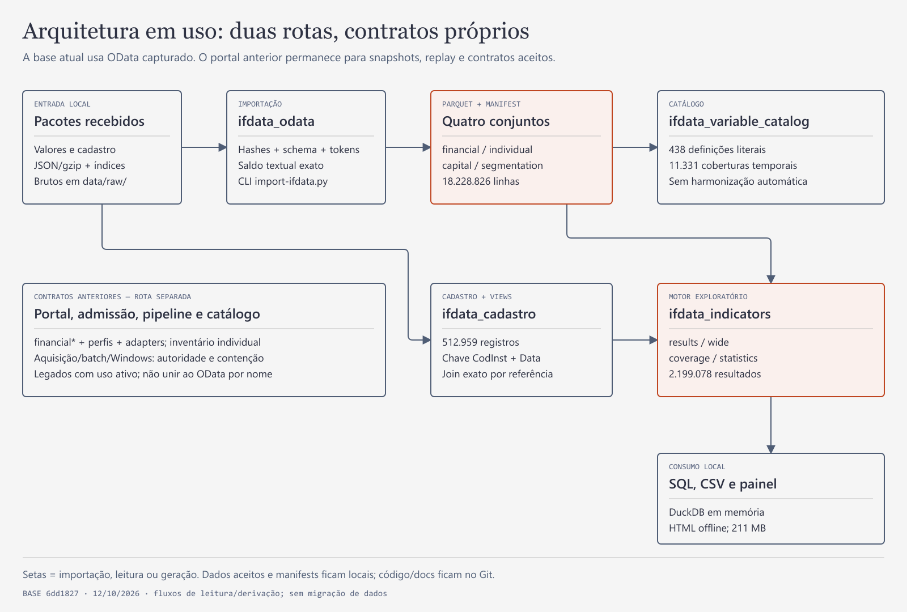

# Dados bancários para a monografia

Este projeto apoia a monografia de Ciências Econômicas de João Victor Santos Gonçalves Pereira, na UNICAMP, sobre a evolução do **desempenho econômico-financeiro dos negócios financeiros no Brasil**. O desenho compara o sistema observado IF.data, as unidades vinculadas às companhias abertas selecionadas, o restante e os vínculos desconhecidos. O sistema observado não é um censo de toda atividade financeira brasileira.

O núcleo acadêmico é **2010–2024**. **2025–2026** é complemento separado, condicionado às mudanças contábeis, de perímetro e de disponibilidade. A infraestrutura guarda observações nativas e sua proveniência; decisões adotadas, implementações e novas propostas têm estados próprios, apresentados abaixo.

## Como a pesquisa se organiza

[Versão PNG](docs/agents/assets/monograph-research-map-20261013.png). Mapa conceitual de 13/10; o texto abaixo incorpora a comparação sistêmica e as pesquisas posteriores.

**Como ler:** a CVM identifica companhias abertas; B3 complementa a história de instrumentos, sem impor negociação em bolsa ao universo aprovado. IF.data informa **o que foi reportado e por qual unidade/perímetro**. Vínculos temporais formam o recorte das companhias dentro do sistema observado, preservando o restante e o desconhecido. O significado econômico e a disponibilidade conjunta orientam a seleção dos indicadores.

**Alternativa textual:** companhias e instrumentos elegíveis + dados IF.data → vínculo temporal documentado → unidade financeira identificada → indicadores candidatos e componentes compatíveis → comparação e interpretação. Esse percurso é o desenho da pesquisa; não certifica que todos os vínculos ou cálculos já estão concluídos.

## O que será medido

A decisão de **16/10/2026** aprova **55 companhias brasileiras com registro CVM A/B em 31/12/2024**, incluindo AUZZA suspensa: **32 com associação IF.data comprovada, 24 códigos financeiros distintos e 23 sem correspondência principal admitida**. Companhia e unidade financeira são contagens diferentes. Essa ampliação é documental e **não recalculou a base anterior nem retroprojetou os vínculos de 2024**. [Lista nominal, fontes e pendências](docs/engineering/cvm-open-financial-universe-2024-20261016.md).

| Perspectiva | Papel no desenho | Cuidado principal |
|---|---|---|
| Financeira | Perspectiva principal do sistema observado e de seus recortes por vínculo às companhias. | O perímetro do IF.data não é automaticamente toda a holding; Td=I não prova independência societária. |
| Prudencial | Considerar indicadores e comparações pertinentes, especialmente capital e solidez; também oferece balanço e DRE. | Identificar perímetro, referência e regime próprios; não transportar índices para a unidade financeira como se fossem equivalentes. |
| Individual | Recurso para perguntas específicas sobre uma entidade. | Não somar às observações consolidadas ou exigir uma segunda amostra completa por rotina. |

O conjunto atual tem **dez métricas implementadas**: ROA, ROE, provisão/crédito, custo de provisão/crédito médio, PL/AT, PR/RWA, capital principal/RWA, liquidez imediata, crédito/depósitos e eficiência E2-B. Trimestres efetivos, fluxos de doze meses e médias de estoques ponderadas pelo tempo já têm decisão e contrato. A [revisão por atividade](docs/engineering/financial-indicators-activity-review-20261016.md) examina seus limites no sistema inteiro e recomenda **sete complementos prioritários ainda candidatos**; não certifica as cinco dimensões adequadamente cobertas em todo negócio.

Adoção desses complementos, fontes adicionais, recálculo para as 55 companhias e eventual índice/econometria exigem decisões e tarefas próprias. Não há uma fórmula diferente por cruzamento cadastral. [Protocolo e decisões](docs/engineering/institution-type-indicator-methodology-20261012.md) · [Issue 3](https://github.com/joaosantossgp/brazilian_banks_data_quality/issues/3).

## Fórmulas e indicadores por recorte

O [atlas com explicações, variáveis nativas e fontes](docs/engineering/financial-indicators-formulas-20261017.md) reúne os dez indicadores atuais e sete propostas nas cinco dimensões. Cada quadro completo mostra nome, fórmula, contas/relatórios IF.data, interpretação e referência por indicador. As marcas de uso são condicionais; não comprovam calculabilidade de toda unidade.

| Recorte | Papel na análise | Quadro completo |
|---|---|---|
| Tcb | Tipo institucional observado; conferir negócio e SegmentoTb. | [SVG Tcb](docs/agents/assets/financial-indicators-formulas-13-tcb-indicators-20261017.svg) · [PNG Tcb](docs/agents/assets/financial-indicators-formulas-13-tcb-indicators-20261017.png) |
| SegmentoTb | Famílias econômicas interpretativas, com os 25 rótulos financeiros na legenda. | [SVG SegmentoTb](docs/agents/assets/financial-indicators-formulas-12-all-segments-20261017.svg) · [PNG SegmentoTb](docs/agents/assets/financial-indicators-formulas-12-all-segments-20261017.png) |
| Tc | Controle público, privado nacional ou estrangeiro; estratifica, sem mudar a fórmula. | [SVG Tc](docs/agents/assets/financial-indicators-formulas-14-tc-indicators-20261017.svg) · [PNG Tc](docs/agents/assets/financial-indicators-formulas-14-tc-indicators-20261017.png) |
| Td | Conglomerado/instituição e seu perímetro; I não certifica independência. | [SVG Td](docs/agents/assets/financial-indicators-formulas-15-td-indicators-20261017.svg) · [PNG Td](docs/agents/assets/financial-indicators-formulas-15-td-indicators-20261017.png) |
| Sr original | Regime prudencial S1–S5 e desconhecido; não simples faixa de tamanho. | [SVG Sr](docs/agents/assets/financial-indicators-formulas-16-sr-indicators-20261017.svg) · [PNG Sr](docs/agents/assets/financial-indicators-formulas-16-sr-indicators-20261017.png) |

SrAnalitico é derivado e permanece em recorte separado do Sr original. Atividade foi retirada dos filtros analíticos. Financeiro, Prudencial e Individual conservam conceitos, unidades e perímetros próprios; classificação ausente não é não aplicabilidade.

## Por onde começar

| Quero… | Leia |
|---|---|
| Entender os conceitos e diferenças entre unidades | [Glossário](GLOSSARY.md). |
| Conhecer a fundamentação e as lacunas metodológicas | [Referências comentadas](REFERENCES.md). |
| Conferir as companhias do corte aprovado | [Universo de 55 companhias: identidades, vínculos e limites](docs/engineering/cvm-open-financial-universe-2024-20261016.md). |
| Revisar indicadores, adequação por negócio e disponibilidade | [Pesquisa do sistema inteiro](docs/engineering/financial-indicators-activity-review-20261016.md), [matriz de cobertura](docs/engineering/financial-indicators-activity-coverage-20261016.csv) e [proveniência](docs/engineering/financial-indicators-activity-review-20261016.provenance.md). |
| Consultar dados, componentes ou o piloto | [Guia de consultas locais](docs/engineering/local-queries-20261013.md). |
| Entender módulos, tabelas e relações | [Mapa técnico e dicionário físico](docs/engineering/repository-review-20261012.md). |
| Contribuir como agente | [AGENTS](AGENTS.md), depois a Issue real e seus contratos. |
| Acompanhar execução e decisões | [Mapa das frentes — Issue 2](https://github.com/joaosantossgp/brazilian_banks_data_quality/issues/2), com atualizações datadas. |

## O que já existe — posição documental em 17/10/2026

A base técnica descrita nas entregas [84](https://github.com/joaosantossgp/brazilian_banks_data_quality/pull/84), [85](https://github.com/joaosantossgp/brazilian_banks_data_quality/pull/85) e [87](https://github.com/joaosantossgp/brazilian_banks_data_quality/pull/87) reúne valores, cadastro e catálogo temporal. Os registros dessas entregas informam **18.228.826 observações nativas**; financeiro/individual cobrem 66 referências de 201003 a 202606. Capital e segmentação têm janelas próprias. Isso descreve a base técnica, não a amostra final nem séries harmonizadas da monografia.

[SVG do mapa técnico](docs/agents/assets/repository-architecture-20261012.svg). **Alternativa textual:** fontes preservadas alimentam leitores e conjuntos consultáveis; cadastro identifica ocorrências por data; catálogo registra definições/cobertura; piloto explora indicadores com regras explícitas. Consulte o [relatório técnico](docs/engineering/repository-review-20261012.md) para relações e limites observados.

A [implementação das dez métricas](docs/engineering/ifdata-monograph-analysis-20261014.md) e sua [ampliação ao universo observado IF.data](docs/engineering/ifdata-universe-analysis-20261014.md) estão entregues. O motor compara sistema completo, vinculadas, restante e desconhecido, com cobertura e distribuição, nas perspectivas próprias. Esses cálculos usam a seleção/vínculos dos contratos anteriores; não são o recálculo das 55 companhias. As notas datadas preservam o que foi produzido e as correções posteriores.

O [piloto exploratório anterior](docs/engineering/ifdata-indicator-pilot-20261011.md) conserva oito candidatos/variantes e seus diagnósticos; não limita o motor atual nem a pesquisa de ampliação.

**O clone não contém a base local.** Dados e artefatos aceitos são ignorados pelo Git. A [Release IF.data de 12/10/2026](https://github.com/joaosantossgp/brazilian_banks_data_quality/releases/tag/snapshot-ifdata-20261012) tem transporte criptografado e instruções de restauração próprias; não substitui o código nem o handoff de outras frentes.

## Frentes e decisões

A [pesquisa do universo de companhias, Issue 142](https://github.com/joaosantossgp/brazilian_banks_data_quality/issues/142), e a [revisão dos indicadores, Issue 143](https://github.com/joaosantossgp/brazilian_banks_data_quality/issues/143), são as entradas recentes. A [revisão documental de 17/10](docs/engineering/documentation-review-20261017.md) registra reconciliações, alcance e lacunas. Ledgers e Issues conservam execução/aceite; o README orienta a leitura.

As decisões restantes estão na [Issue 3](https://github.com/joaosantossgp/brazilian_banks_data_quality/issues/3): adoção das novas propostas, tratamentos e fontes adicionais, representatividade, eventual índice/econometria e reconciliação do manuscrito. Seleção e janelas já aprovadas não voltam ao estado de indecisas. Desconhecido não significa inelegível; presença de dados não certifica comparabilidade.

## Consultas locais e reprodução

O [guia operacional](docs/engineering/local-queries-20261013.md) concentra comandos e contextos, preservando OData, portal histórico e contratos de cada pacote. A revisão documental não reexecutou consultas, builds ou replays.

| Destino | Uso e limite |
|---|---|
| [Valores IF.data](docs/engineering/local-queries-20261013.md#consultar-a-base-ifdata) | `financial`, `individual`, `capital` e `segmentation` mantêm tipos/contextos próprios; IDs OData e portal não são intercambiáveis. |
| [Catálogo temporal](docs/engineering/local-queries-20261013.md#catálogo-temporal-de-variáveis) | Definições e cobertura; nome/código estável não certifica equivalência. |
| [Cadastro e vínculos](docs/engineering/local-queries-20261013.md#cadastro-temporal-e-vínculos) | Código/data não comprova sozinho identidade com companhia aberta. |
| [Piloto anterior](docs/engineering/local-queries-20261013.md#piloto-de-indicadores-consultável) | Exploração histórica; não limita nem substitui o motor atual. |
| [Comandos preservados](docs/engineering/local-queries-20261013.md#comandos-locais-verificados) | Conferir entradas, destinos e contrato antes de executar. |

## Contratos e histórico

[Arquitetura e destinos](docs/architecture.md) · [Workflow](docs/agents/workflow.md) · [Tracker](docs/agents/issue-tracker.md) · [Modelo lógico](docs/superpowers/specs/2026-10-04-logical-data-model-design.md) · [Histórico operacional](docs/agents/operational-history-20261013.md).

Referências antigas às linhas deste README encontram seu contexto na [versão anterior preservada no Git](https://github.com/joaosantossgp/brazilian_banks_data_quality/blob/f93d37f17898d69713d06f07bb393eb1f2444331/README.md).

A licença própria do código/documentação ainda não foi escolhida; notices e licenças upstream conservam seu alcance. Fontes privadas, dados locais e credenciais não são publicação automática.
