# Fórmulas abertas por recorte — atlas IF.data

Documentação visual da [pesquisa 143](financial-indicators-activity-review-20261016.md), solicitada por João em 17/10/2026. O universo principal é **todo o sistema observado**, não somente as 32 companhias associadas no corte documental de 2024. As figuras descrevem dez métricas atuais e sete propostas prioritárias; não adotam novas fórmulas nem executam cálculos.

Cada árvore abre numerador e denominador, identifica a conta e o relatório e apresenta a pergunta econômica e o limite do recorte. Todas as razões estão em %. **ATUAL** indica fórmula do motor existente; **PROPOSTA**, candidata de classe 2 que exige contrato e decisão posterior. LF reúne quatro participações, sem criar uma quinta razão pela soma delas. As alternativas de menor prioridade e as medidas que exigem fonte adicional permanecem nas fichas da pesquisa.

## Como escolher o recorte

As famílias são hipóteses interpretativas para avaliar adequação, não classificação histórica implementada. `Tcb` e `SegmentoTb` são pistas do negócio; os rótulos literais, datas, quantidades e cobertura conjunta estão na [matriz da pesquisa](financial-indicators-activity-coverage-20261016.csv) e na sua [versão integral compactada](financial-indicators-activity-coverage-20261016.csv.gz). Não há uma fórmula diferente para cada cruzamento.

| Família econômica a examinar | Fórmulas comuns ou condicionais | Complementos propostos | Lacuna que permanece |
|---|---|---|---|
| Bancos depositários/diversificados | R1/R2/C1; Q1/Q2 com carteira; L2/L3 com base econômica; E2-B | LA/LC/LF; R4/R5/RS/E3 | Maturidade, atraso/default e renda ampla |
| Bancos cooperativos e cooperativas singulares | R1/R2 como sustentabilidade; C1; Q1/Q2; L2/L3 quando pertinentes; E2-B | LA/LC/LF; R4/R5/RS/E3 conforme operação | Centralização e benefício ao cooperado |
| Centrais/confederações de serviços | R1/R2/C1; E2-B sob composição da renda; Q1/Q2 só com carteira própria | LA/LF/RS/E3 | Exposição interfinanceira e centralização |
| Desenvolvimento/fomento | R1/R2 como sustentabilidade; C1; Q1/Q2; E2-B | LA/LC/LF prioritários; R4/R5/E3 | L2 isolado é insuficiente; vencimentos e mandato |
| Crédito não bancário/imobiliário/arrendamento | R1/R2/C1; Q1/Q2 apenas com carteira compatível; E2-B | LA/LC/LF; R4/R5/E3 | Leasing não é somado ao crédito automaticamente |
| Mercado de capitais/investimento/câmbio | R1/R2/C1; E2-B condicionado à renda; Q1/Q2 só com crédito próprio | RS; LA com restrições; E3/R4 conforme composição | Obrigações com clientes, margens, contraparte, volumes |
| Pagamentos | R1/R2/C1 da operadora; E2-B com composição de serviços | RS; LA/E3 com restrições | Salvaguarda, liquidação, transações; DV não é conta de pagamento |
| Desconhecida ou conflitante | Preservar observações e medir disponibilidade | Examinar conceitos antes de selecionar família | Não converter falta de classificação em exclusão |

C3/C4 são uma leitura **Prudencial separada**, somente nas unidades/regimes pertinentes a cada família. `Tc` estratifica controle; `Td`, consolidação; `Sr`, regime prudencial. `Td=I` não prova independência societária; `Sr` não é simples tamanho. `SrAnalitico` é derivação separada do original, com origem e conflitos preservados. `Atividade` não volta aos filtros nem funciona como classificação oculta.

## Recortes cadastrais abertos: Tcb, Tc, Td e regime

Estes três mapas complementam as árvores de fórmula. A contagem é uma consulta determinística da matriz já revisada: `dataset=financial`, `period=202412`, `candidate=LAcore`, `cohort=system_observed`. Nenhuma razão foi recalculada. O corte é ilustrativo; não fixa os atributos de 2024 no histórico. Cada eixo recompõe as mesmas 1422 unidades, sem somar eixos entre si.

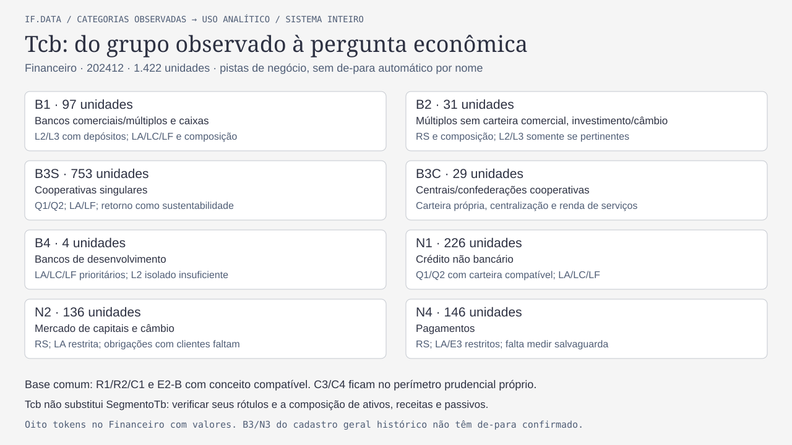

[PNG Tcb](../agents/assets/financial-indicators-formulas-09-tcb-20261017.png). Alternativa textual: B1, 97 unidades; B2, 31; B3S, 753; B3C, 29; B4, 4; N1, 226; N2, 136; N4, 146. São as oito categorias nas unidades financeiras com valores, distintas dos dez tokens do cadastro geral histórico. B1 inclui múltiplos com carteira comercial/comerciais/caixas; B2 reúne múltiplos sem carteira comercial, investimento e câmbio. B3 e N3 do cadastro geral permanecem sem de-para confirmado, não são forçados a uma família. C1/R1/R2 são leituras contábeis comuns condicionais; o negócio e o perímetro determinam a seleção de complementos e os limites de E2-B, Q1/Q2 e L2/L3.

`SegmentoTb` fornece outra abertura: bancos de desenvolvimento e BNDES (B4) não esgotam a família desenvolvimento/fomento, que também examina Agência de Fomento; bancos cooperativos e cooperativas singulares não são equivalentes. Corretoras/distribuidoras e IPs têm obrigações/serviços próprios. A tabela de famílias acima e a tabela literal dos 25 segmentos financeiros na pesquisa mantêm essas distinções; não há de-para automático Tcb→SegmentoTb nem fórmula única para todas as unidades de um token.

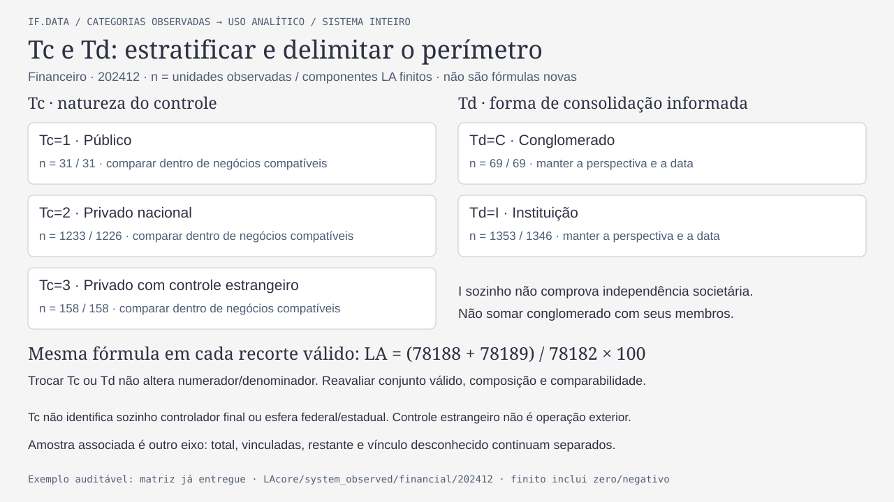

[PNG controle e consolidação](../agents/assets/financial-indicators-formulas-10-control-consolidation-20261017.png). Alternativa textual: Tc=1 tem 31 unidades/31 com componentes LA finitos; Tc=2, 1233/1226; Tc=3, 158/158. Td=C tem 69/69; Td=I, 1353/1346. As cinco contagens não formam uma partição conjunta: cada eixo separadamente soma 1422/1415. As mesmas contas de LA são usadas em cada recorte; controle não altera fórmula e consolidação exige coerência da unidade. Não comparar público/privado como efeito causal sem separar composição de negócios; não somar conglomerado e seus membros. I não comprova ausência de vínculo societário.

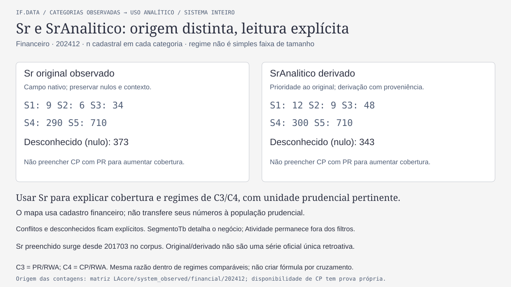

[PNG regime prudencial](../agents/assets/financial-indicators-formulas-11-prudential-cuts-20261017.png). Alternativa textual: no Sr original financeiro de 202412, S1/S2/S3/S4/S5 têm 9/6/34/290/710 unidades e há 373 nulos; SrAnalitico tem 12/9/48/300/710 e 343 nulos. A diferença não recupera um Sr oficial nem prova licença ou opção regulatória. Proveniência de derivação e conflitos são preservados. Os números são cadastro financeiro, não população do relatório Capital; a disponibilidade dos componentes C3/C4 tem prova própria. `Atividade` segue excluído dos filtros.

## 1. Rentabilidade e estrutura patrimonial

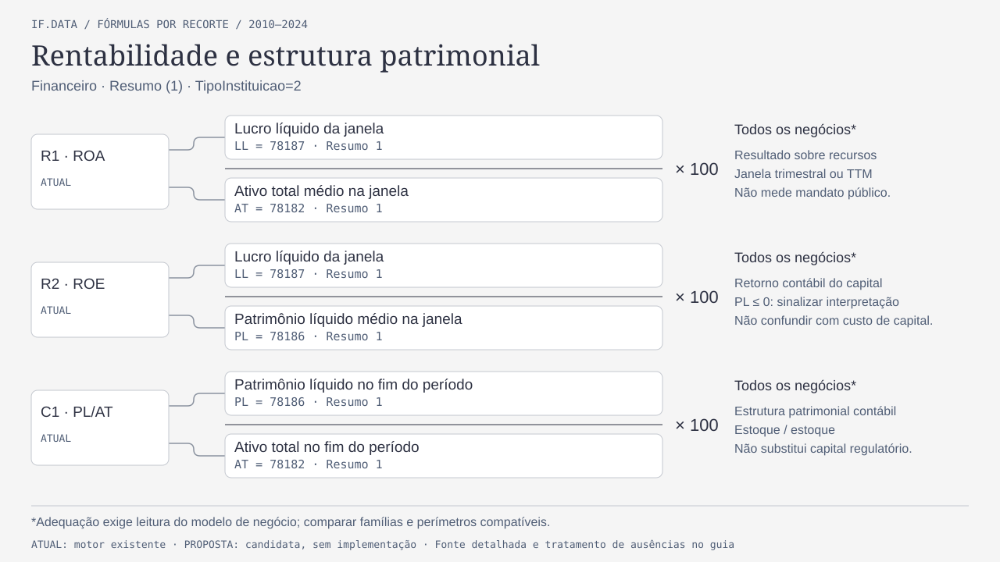

[PNG em resolução 2560 × 1440](../agents/assets/financial-indicators-formulas-01-common-20261017.png). Alternativa textual: R1 = LL da janela / AT médio; R2 = LL da janela / PL médio; C1 = PL / AT no fim do período. R1/R2 preservam lucro ou prejuízo; PL negativo impede leitura de retorno com pesos convexos. Sustentabilidade contábil não mede benefício cooperativo ou cumprimento do mandato público.

## 2. Provisões e crédito

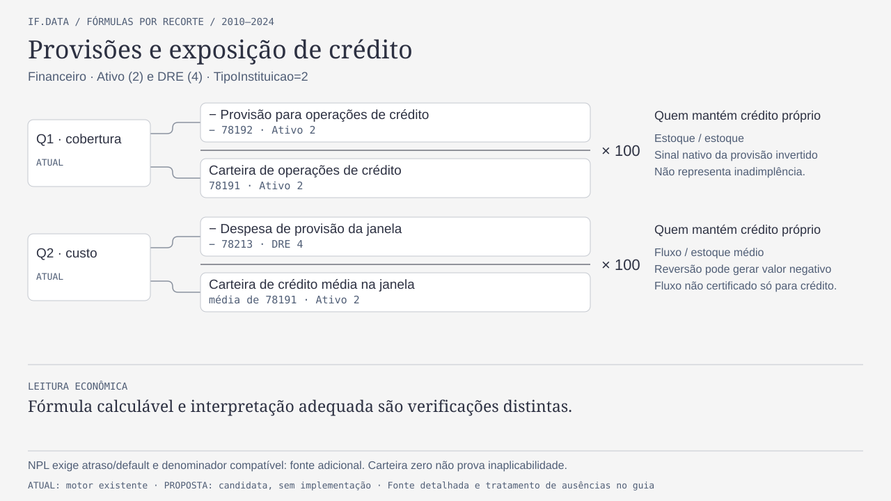

[PNG](../agents/assets/financial-indicators-formulas-02-credit-20261017.png). Alternativa textual: Q1 = −x78192/x78191; Q2 = −x78213 da janela / média de x78191, vezes 100. O sinal negativo concilia o sinal nativo, sem aplicar valor absoluto. Reversões conservam resultado negativo. A abrangência de 78213 não está certificada como exclusiva à carteira de crédito, limite explícito do motor atual. São medidas de provisão, não inadimplência; carteira própria e arrendamento exigem perímetros distintos.

## 3. Capital prudencial

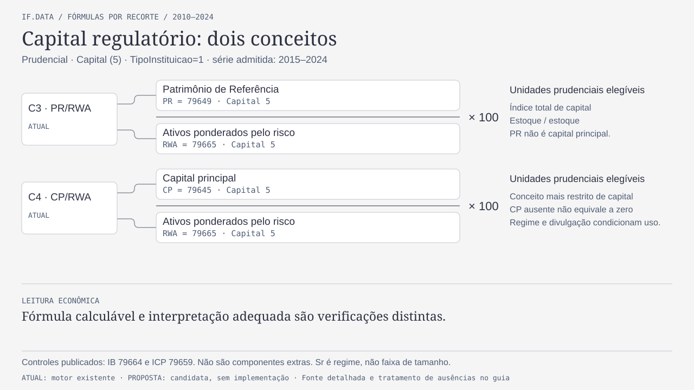

[PNG](../agents/assets/financial-indicators-formulas-03-capital-20261017.png). Alternativa textual: C3 = PR/RWA; C4 = capital principal/RWA, vezes 100, no dataset Capital/TipoInstituicao 1/relatório 5. IB 79664 e ICP 79659 servem de controles publicados. Ausência de CP não autoriza preencher com PR nem excluir silenciosamente a unidade.

## 4. Liquidez e crédito/depósitos

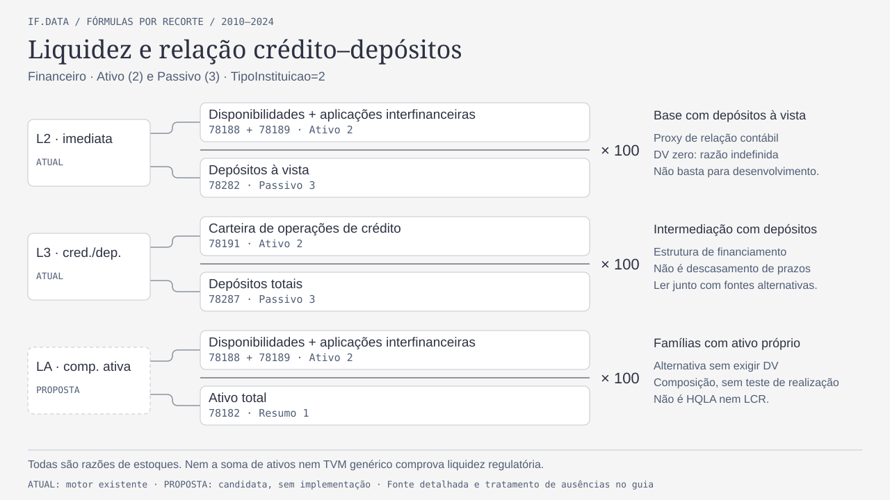

[PNG](../agents/assets/financial-indicators-formulas-04-liquidity-20261017.png). Alternativa textual: L2 = (78188+78189)/78282; L3 = 78191/78287; LA proposta = (78188+78189)/78182, vezes 100. LA amplia a descrição contábil sem certificar elegibilidade ou realização dos ativos. Nenhuma dessas razões é LCR; LA não resolve sozinha a lacuna de liquidez de desenvolvimento/pagamentos.

## 5. Ativo e fontes de captação

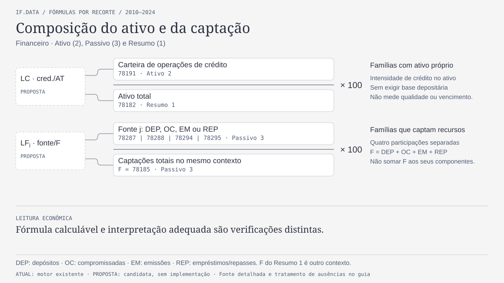

[PNG](../agents/assets/financial-indicators-formulas-05-funding-20261017.png). Alternativa textual: LC = 78191/78182. LF são quatro razões separadas: 78287/F, 78288/F, 78294/F e 78295/F, vezes 100. F = 78185 **do Passivo 3**, cuja identidade com a soma das quatro rubricas foi conciliada no corpus. Não somar o pai às filhas nem duplicar F do Resumo 1. Captações não equivale ao total de obrigações, funding disponível ou estabilidade por prazo.

## 6. Eficiência e composição de serviços

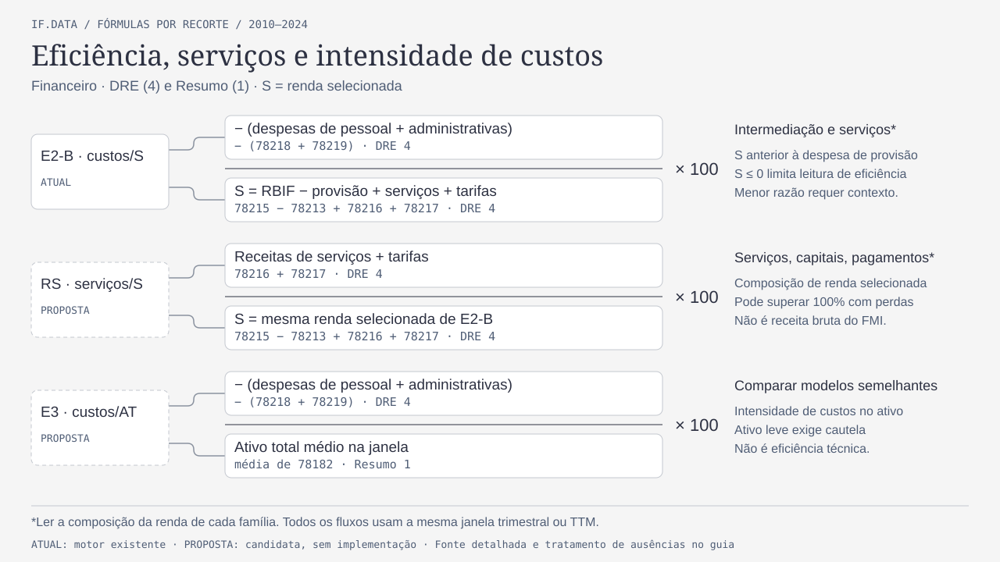

[PNG](../agents/assets/financial-indicators-formulas-06-efficiency-20261017.png). Alternativa textual: C = −(78218+78219); S = 78215−78213+78216+78217. E2-B = C/S; RS proposta = (78216+78217)/S; E3 proposta = C/AT médio, vezes 100. S é renda selecionada anterior à despesa de provisão, não receita bruta do FMI ou renda operacional completa. RS pode superar 100% se outras parcelas forem negativas. E3 é intensidade de custos, sensível a modelos de ativo leve; não eficiência técnica.

## 7. Margem e rendimento do crédito

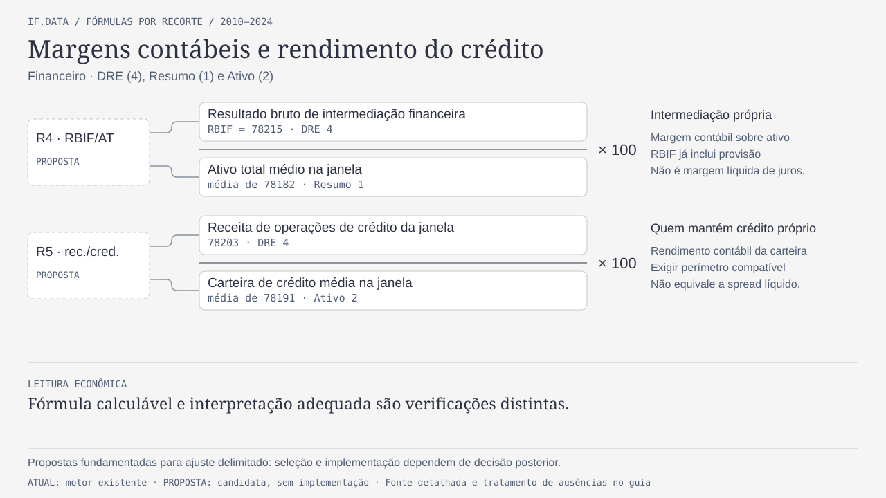

[PNG](../agents/assets/financial-indicators-formulas-07-margins-20261017.png). Alternativa textual: R4 proposta = 78215/AT médio; R5 proposta = 78203/crédito médio, vezes 100, na mesma janela. RBIF já inclui provisão. R4 não é NIM e R5 não é spread líquido; exigir compatibilidade entre receita e carteira produtora.

## 8. Janelas e agregação dos recortes

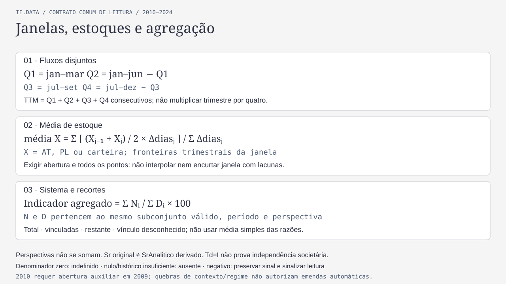

[PNG](../agents/assets/financial-indicators-formulas-08-time-cohorts-20261017.png). Alternativa textual: Q1 = jan–mar; Q2 = jan–jun menos Q1; Q3 = jul–set; Q4 = jul–dez menos Q3. TTM soma quatro trimestres consecutivos disjuntos. A média de estoque é `Σ[((X anterior + X atual)/2) × dias do intervalo]/Σdias`, exigindo abertura e fronteiras trimestrais. O agregado é `ΣN/ΣD × 100`, com a mesma interseção válida para N e D; não média simples das razões, nem soma de percentuais de famílias diferentes.

As quatro leituras são sistema observado completo, vinculadas, restante e vínculo desconhecido. Total inclui as três parcelas quando o pertencimento forma uma partição válida. Mostrar unidades e companhias separadamente, além de AT/crédito/PL conhecidos, contagem e composição de cada subconjunto. As 32 companhias/24 códigos de 2024 não são uma associação retroativa para 2010.

## Contextos, disponibilidade e regras que acompanham toda figura

Os IDs das figuras são `CodConta` dentro de dataset/perspectiva, `TipoInstituicao`, relatório e contexto próprios. A [matriz de componentes](financial-indicators-activity-components-20261016.csv) preserva 212 contextos, grupos, nomes, descrições e datas; ID isolado não é chave suficiente. Financeiro tem TipoInstituicao 2, relatórios 1–4; Individual usa TipoInstituicao 3 e bindings próprios, sem herdar prova de cobertura do Financeiro. Capital prudencial usa TipoInstituicao 1/relatório 5. Não somar perspectivas nem emprestar numerador entre perímetros.

O corpus principal contém 60 trimestres financeiros/individuais de 2010–2024; Capital, 40 desde 201503; segmentação, 32 desde 201703. Presença conjunta contemporânea não comprova calculabilidade com histórico: no Financeiro, os componentes contábeis prioritários estão finitos em 88782/89476 posições, inclusive zeros e negativos. Q2, ROA/ROE e demais razões com médias ainda exigem janela completa; L2 tem 37639 posições com DV zero e 694 com componentes nulos. A cobertura por conta/eixo/período/coorte está na pesquisa, não é inferida das figuras.

Denominador zero torna a razão indefinida; numerador zero com denominador válido pode produzir zero. Nulo, ausência de binding, falta de histórico, definição incompatível e classificação desconhecida são estados distintos. Negativos conservam o sinal e exigem interpretação; não usar módulo, truncamento ou preenchimento para melhorar cobertura. Falta de dados não demonstra não aplicabilidade.

Preservar a quebra do lucro em 201903 e a ponte específica, mudanças de Outros Depósitos em 202006 e Passivo Total em 202212, regimes prudenciais/CP desde 2018 e a fronteira Cosif 2025. Dezembro não prova resultado anual. Não incluir Passivo Total como exigível nem reconstruir depósitos pela soma de folhas sem conciliar definições.

## Fundamentos e proveniência visual

As figuras traduzem fichas já pesquisadas, sem nova leitura bibliográfica: Assaf Neto, **11. ed., 2015**, pp. 333–335, 337, 341–342, relidas na pesquisa 143; pp. 321–331 reaproveitadas da 111. R1/R2, C1 e L2/L3 têm fundamentos nas páginas 341, 337 e 334–335; Q1/Q2 reaproveitam p. 324 e normas contábeis; R4/R5 usam p. 342 com adaptação de médias. LA/LF/RS/E3 são adaptações explicitadas, não fórmulas literais atribuídas ao autor. Normas CMN/BCBS, FMI 2019 e literatura de atividades têm localizadores, versões, divergências e links nas [fichas e bibliografia](financial-indicators-activity-review-20261016.md) e na [proveniência](financial-indicators-activity-review-20261016.provenance.md).

Fontes de implementação: `metric_definitions`, `evaluate_metric`, preparação de fluxos e `mean_stock` em [ifdata_analysis.py](../../bank_quality/ifdata_analysis.py). A documentação distingue a matemática atual das sete propostas, sem modificar o módulo ou regenerar a base. A disponibilidade e a classificação por família continuam condicionadas às evidências da pesquisa.

Produção com a skill `diagram-design`, padrão claro escolhido no projeto, oito árvores/contratos e três mapas cadastrais, com até nove nós por painel, SVG 1280 × 720 e PNG 2560 × 1440. HTML e scripts de geração/renderização são fontes temporárias privadas. Tipografia local Arial/Georgia/Consolas, substituições explícitas das famílias sugeridas pela skill. Exportação por Playwright Node e Chromium já disponíveis; não houve instalação de runtime/dependência. O atlas e seus assets são documentação sob responsabilidade da Issue143; revisão por fatias e conferência final registradas na Issue. O complemento cadastral foi solicitado após a primeira publicação do PR147, sem inferir nova adoção metodológica.
