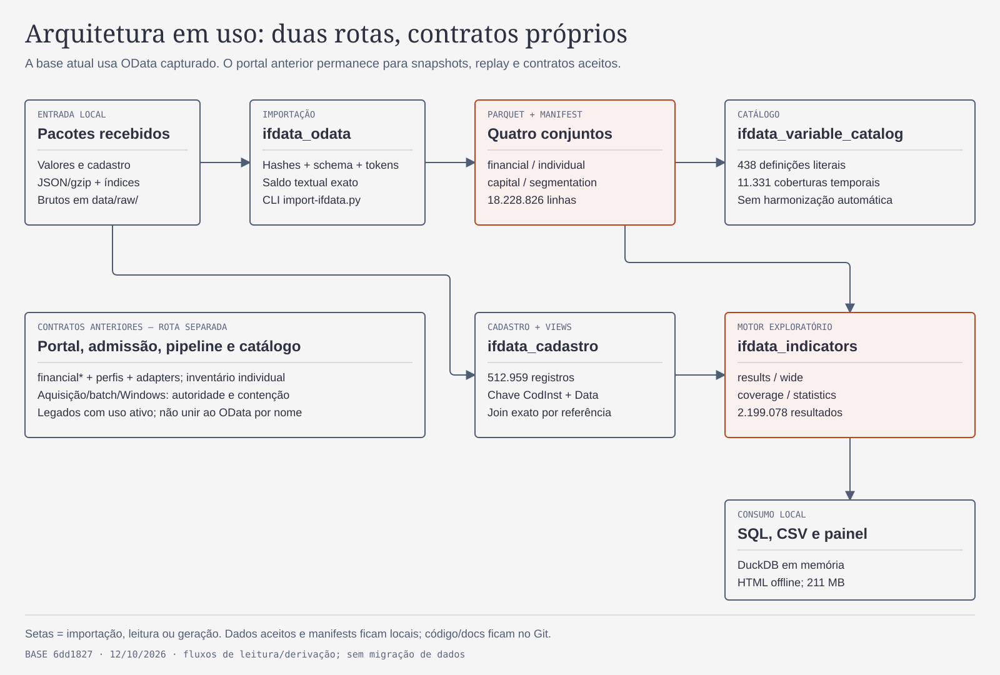
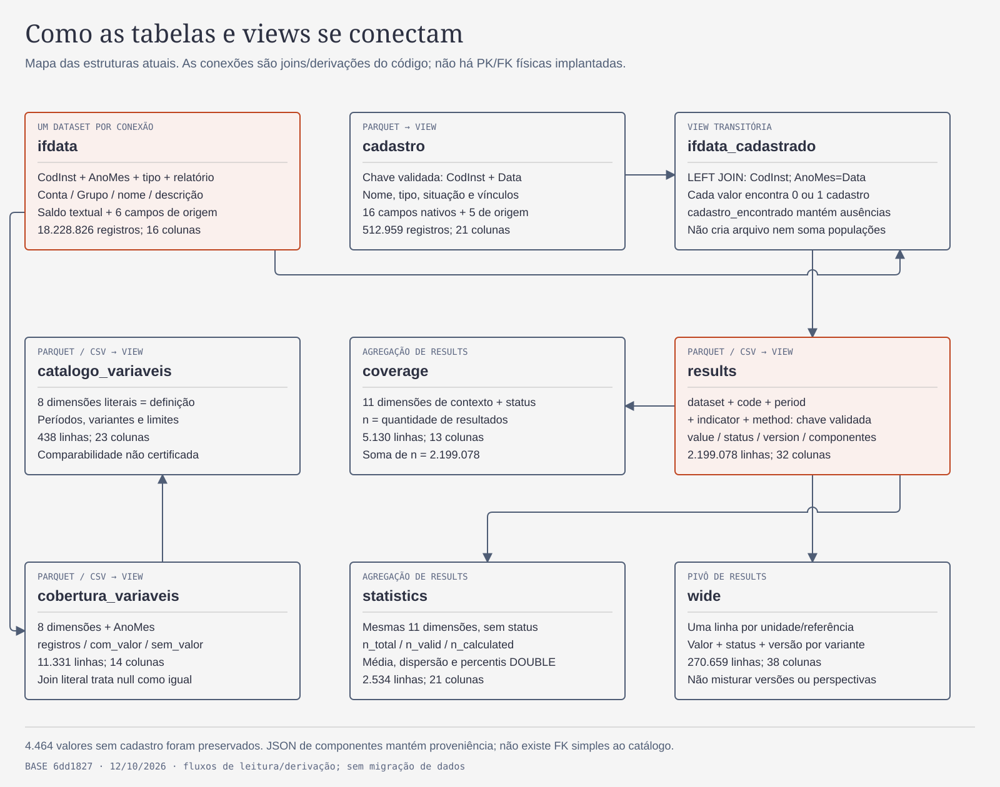

# Revisão do repositório e guia das tabelas IF.data — 12/10/2026

**Snapshot técnico de12/10, preservado — leitura corrente de17/10/2026:** os módulos, tabelas e mapas abaixo descrevem a base auditada nessa data. A [arquitetura corrente](../architecture.md) registra extensões posteriores; os motores de indicadores [127](ifdata-monograph-analysis-20261014.md) e [130](ifdata-universe-analysis-20261014.md) têm módulos, contratos e resultados próprios. O [README](../../README.md) orienta a pesquisa atual e a [revisão documental](documentation-review-20261017.md) explica a reconciliação. Este inventário não deve ser usado como prova de que módulos/entregas posteriores inexistem, nem como autorização para remover os leitores históricos.

[Issue 91](https://github.com/joaosantossgp/brazilian_banks_data_quality/issues/91). Base auditada: `6dd18273dd476c09c6f822928bff6b6743346d25`. Esta é uma revisão do estado existente, com documentação explicativa nova; não executa refatoração, exclusão de legados, aquisição ou mudança metodológica. Autor: Root; revisão independente de módulos/código e conferência final registradas na Issue. Contratos de organização: [arquitetura](../architecture.md), [glossário](../../GLOSSARY.md) e [workflow](../agents/workflow.md).

## Parecer

A separação entre código reutilizável, CLIs, testes, documentos e dados locais é reconhecível e deve ser preservada. A base atual tem leitores autenticados, preservação de tokens/Decimal, cadastro temporal e estados explícitos de indisponibilidade. O principal problema de organização é a distância entre a documentação cumulativa e os caminhos que um usuário precisa entender hoje: coexistem duas famílias de contratos, e o mapa lógico aprovado anteriormente não representa as tabelas físicas OData atuais.

Não há evidência para reescrever o pacote ou apagar a cadeia do portal. Foram identificados um problema reproduzido de seleção na importação OData, uma lacuna de CI Windows e dívidas de documentação/interfaces. Nenhum achado invalida por si os dados restaurados: as seleções efetivamente importadas, contagens, hashes e relações desse corpus foram conferidas. A cobertura acadêmica e a comparabilidade continuam sujeitas aos contratos de domínio.

## Achados priorizados

| ID | Prioridade | Evidência e consequência | Encaminhamento proposto |
|---|---|---|---|
| R1 | P2 — comportamento | [ifdata_odata.py:132](../../bank_quality/ifdata_odata.py#L132) filtra a seleção e [:190](../../bank_quality/ifdata_odata.py#L190) exige somente algum arquivo. A fixture confirma que pedir dois períodos ou tipos aceita apenas um, mantendo ambos nos seletores do manifest; pedir relatório inexistente aceita partes vazias. O consumidor não consegue distinguir entrada faltante de ausência comprovada apenas pelo pedido registrado. | Regressões TDD para seleção total/parcial/vazia; registrar solicitado versus encontrado e distinguir falta de entrada, zero observado e ausência comprovada. Não transformar todo zero em erro. |
| R2 | P2 — validação | [ci.yml:13](../../.github/workflows/ci.yml#L13) usa somente Ubuntu. Vinte testes específicos de Windows ficam em skip, incluindo contenção, árvore de processos e pipeline. CI verde não comprova esses caminhos nativos. | Job Windows offline direcionado, medido e sem coleta. Isso é lacuna de verificação, não demonstração de falha do código Windows. |
| R3 | P2 — orientação | [README:70](../../README.md#L70) intercala o estado atual com a rota de 11/66 referências; [:76](../../README.md#L76) ainda descreve o piloto inicial como comportamento implementado. [Arquitetura:56](../architecture.md#L56) acumula versões, e a seção de base alvo conserva o modelo conceitual anterior. As ressalvas históricas existem, mas o leitor precisa reconstruir a cronologia para descobrir qual CLI/schema usar. | Uma entrada atual curta e uma matriz de contratos; mover apenas a apresentação histórica para seção própria, preservando evidência e links. Não apagar ledgers. |
| R4 | P2 — compreensão de dados | Os quatro assets visuais existentes mostram workflow e modelo lógico, sem o mapa das tabelas OData/cadastro/catálogo/indicadores. O [modelo anterior](../superpowers/specs/2026-10-04-logical-data-model-design.md#L31) explicita que não afirma implantação física. Usá-lo como DDL levaria a procurar `cell`/`variable_binding` que não são as views atuais. | Os dois mapas abaixo e o dicionário desta revisão suprem a explicação atual, sem substituir o modelo conceitual aprovado nem inventar PK/FK físicas. |
| R5 | P3 — manutenção | Perfis e aquisição acessam internals de coordenadores: [financial_report_profiles.py:578](../../bank_quality/financial_report_profiles.py#L578), [:643](../../bank_quality/financial_report_profiles.py#L643); aquisição/batch têm dependências recíprocas, resolvidas por imports tardios. [financial_pipeline.py:287](../../bank_quality/financial_pipeline.py#L287) pina onze módulos. Alterar bytes nesse núcleo invalida planos por design. | Delimitar interfaces de contratos/verificação/execução por fatias, mantendo autenticação e compatibilidade explícitas. Não afrouxar pins para facilitar refatoração. Tamanho/ciclo não são, isoladamente, bugs de runtime. |
| R6 | P3 — navegação | Cinco links Markdown relativos não resolvem: quatro em [plano da fundação:75](../superpowers/plans/2026-10-02-governance-foundation-plan.md#L75), um em [plano de indicadores:8](../superpowers/plans/2026-10-11-indicator-pilot.md#L8). As referências aparecem em texto/template de plano; o scanner não valida âncoras ou links externos. | Corrigir caminhos relativos em lote documental pequeno; adotar conferência de links internos com exclusões explícitas para templates. |

Prioridades: P2 afeta uso correto, completude verificável ou entendimento; P3 reduz custo de manutenção/navegação. Não foi demonstrado achado P0/P1 neste recorte. A revisão é amostrada no núcleo legado; não certifica ausência de defeitos em todos os caminhos.

### Reprodução de R1

O revisor usou `ODataImportTests` de `tests/test_ifdata_odata.py`, com diretórios temporários, `import_package` e consulta por `open_dataset`, seguida de cleanup. Fonte da fixture: somente período 201003/tipo 2/relatório 1.

| Pedido | Aceite observado | Consulta real |
|---|---|---|
| `periods=[201003,201006]` | 3 registros; ambos os períodos no pedido do manifest | Somente 201003 |
| `types=[2,3]` | 3 registros; ambos os tipos no pedido do manifest | Somente tipo 2 |
| `reports=['999']` | Manifest aceito com zero registros | Nenhuma linha |

Contraste: [ifdata_cadastro.py:43](../../bank_quality/ifdata_cadastro.py#L43) rejeita períodos solicitados ausentes do índice. A contraprova verifica comportamento de seleção; não é evidência de truncamento na base real entregue.

## Organização e módulos em uso

[PNG do mapa](../agents/assets/repository-architecture-20261012.png).

Alternativa textual: pacotes recebidos em `data/raw/` → `ifdata_odata` → quatro conjuntos Parquet + manifest. O cadastro é importado por `ifdata_cadastro` e ligado aos valores por código/data. `ifdata_variable_catalog` agrega definições/cobertura dos valores. `ifdata_indicators` usa valores/cadastro/aberturas para resultados, pivô, cobertura, estatística e painel. A cadeia do portal permanece separada para contratos anteriormente aceitos, sem conversão implícita para o namespace OData.

| Família | Responsáveis e entradas | Situação observada |
|---|---|---|
| Consulta atual OData | `ifdata_odata`, `ifdata_cadastro`, `ifdata_variable_catalog`, `ifdata_indicators`; CLIs `import-ifdata.py`, `import-ifdata-cadastro.py`, `catalog-ifdata-variables.py`, `pilot-ifdata-indicators.py` | Caminho usado pelo snapshot atual; DuckDB em memória e Parquet/CSV/manifests locais. |
| Inventário individual inicial | `ifdata`, `portal`, `archive`, `inventory`, `coverage`, `metadata`, `replay`, `parquet`; `python -m bank_quality` | Compatibilidade/replay do piloto inicial. A CLI do pacote continua orientada a esse piloto; não é uma CLI unificada de todas as rotas. |
| Financeiro do portal | `financial`, `financial_parquet`, `financial_reports`, `financial_reports_parquet`, `financial_report_profiles`, `financial_catalog` | Admissão, dispatch entre contratos/perfis, projeções numéricas próprias e consultas de snapshots anteriores. |
| Aquisição e contenção | `financial_acquisition`, `financial_acquisition_batch`, `windows_acquisition`, `financial_acquisition_compat` | Autoridade, budgets, checkpoints, processo/Windows e reconstrução histórica. Não é necessária para consultar o snapshot OData. Sua execução exige escopo próprio. |
| Pipeline do portal | `financial_pipeline`, `windows_financial_pipeline`; `run-financial-pipeline.py` | Coordenação offline da cadeia antiga, com pins e inputs autenticados; contratos não são substituídos pelo OData. |

Inventário versionado na base: **268 arquivos**, sendo **26 módulos Python / 13.399 linhas**, 23 arquivos em scripts, 40 em tests e 85 em docs. `bank_quality/` inclui também perfis/registries JSON; não confundir 45 arquivos do diretório com 45 módulos. Maiores módulos: batch 2.852 linhas, catálogo financeiro 1.378, aquisição 1.366, perfis 1.236 e pipeline 1.141. Esses números são indicadores de superfície para manutenção, não prova de código morto.

**Legado preservável:** `financial.py`/`financial_parquet.py` continuam como interfaces de dispatch; `financial_acquisition_compat.py` é chamado para prova/reconstrução histórica; `_run_serial` é seam de testes offline. Não foi provado que possam ser removidos. Perfis, fixtures `.evidence`, ledgers e dados antigos são evidências/contratos, não arquivos descartáveis por antiguidade.

## Tabelas, views e ligações reais

[PNG do mapa de tabelas](../agents/assets/ifdata-tables-20261012.png).

Alternativa textual: cada `ifdata` guarda valores e proveniência de **um** dataset. O `LEFT JOIN` com `cadastro` por `CodInst` e `AnoMes=Data` gera `ifdata_cadastrado`, conservando valores sem cadastro. O catálogo e sua cobertura agregam os oito campos de definição literal e a referência. O motor gera `results` por unidade/referência/indicador/método; dele derivam `wide`, `coverage` e `statistics`. Componentes e estoques em JSON conservam a evidência de cálculo. O catálogo auxilia inspeção, mas não é uma entrada nem uma FK exigida pelo motor.

Não há banco persistido central, migrations, índices ou constraints SQL implantados. As views são registradas em conexões DuckDB a partir dos paths do manifest. As chaves abaixo são validadas pelo código/observadas no corpus, e os vínculos são joins lógicos, sem FK física. Cada conexão expõe apenas as views que sua API abre; não presumir que todos os nomes coexistam numa sessão.

| Estrutura | Grão e chave | Quantidade / colunas | Origem física |
|---|---|---|---|
| `ifdata` | Uma ocorrência nativa de valor por página/linha. Código+período+conta não é chave garantida; duplicatas de componentes existem. Origem localizável por arquivo/hash/linha no contexto do dataset. | 18.228.826 / 16 | 216 partes em `ifdata-odata-20261011/{financial,individual,capital,segmentation}/` |
| `cadastro` | Código institucional na referência; `(CodInst,Data)` único e não ausente, validado. | 512.959 / 21 | 106 partes em `ifdata-cadastro-20261011/` |
| `vinculos` | Um vínculo declarado por instituição/data/perspectiva, somente quando código de conglomerado existe. Destino pode não constar no mesmo trimestre. | View derivada, 5 colunas | `open_cadastro`, sem Parquet próprio |
| `ifdata_cadastrado` | Mesma ocorrência de valor; 0 ou 1 cadastro correspondente. | Mesmas linhas do dataset / 23 | `attach_values`, view transitória |
| `catalogo_variaveis` | Oito dimensões literais de definição, incluindo dataset, nomes e descrição. | 438 / 23 | Parquet + CSV |
| `cobertura_variaveis` | Oito dimensões + `AnoMes`. | 11.331 / 14 | Parquet + CSV |
| `results` | `(dataset,code,period,indicator,method)`, unicidade validada no build. `version` delimita composição/janela, não identidade econômica universal. | 2.199.078 / 32 | Parquet; CSV omite três campos JSON declarados |
| `wide` | Uma unidade/referência neste corpus; pivô das dez variantes em results, metadados cadastrais preservados. | 270.659 / 38 | Parquet + CSV |
| `coverage` | Onze dimensões de contexto + status. | 5.130 / 13 | Parquet + CSV |
| `statistics` | As mesmas onze dimensões, agrupando estados. | 2.534 / 21 | Parquet + CSV |

### Joins corretos e limites

1. **Valores → cadastro:** `v.CodInst=c.CodInst AND v.AnoMes=c.Data`. `LEFT JOIN`, nunca por nome/CNPJ nem transportando cadastro de outro trimestre. A unicidade do cadastro impede fanout. Conferência real: financeiro 4.210 sem cadastro, individual 0, Capital 219, Segmentação 35; **4.464** preservados, sem multiplicar as 18.228.826 linhas.
2. **Cobertura → catálogo:** `(dataset,TipoInstituicao,NumeroRelatorio,NomeRelatorio,Conta,Grupo,NomeColuna,DescricaoColuna)`, tratando null com `IS NOT DISTINCT FROM`. `dataset` precisa ser acrescentado pelo chamador ao cruzar os quatro conjuntos; não está nas 16 colunas do Parquet nativo. Os 11.331 registros de cobertura encontram exatamente sua definição no corpus; soma de `registros` = 18.228.826.
3. **Resultados → origem:** `code/period` correspondem a `CodInst/AnoMes`, dentro de dataset/perspectiva. É uma relação de cálculo de múltiplos componentes/datas; não um join simples que reproduz o valor. `numerator_definition`, `denominator_definition` e `mean_stock_inputs` guardam linhas/evidências completas, inclusive ocorrências ambíguas. Não juntar results ao catálogo só por `Conta`.
4. **Resultados → pivô/agregados:** a chave de results tem zero duplicatas, assim como `(dataset,code,period)` em wide no corpus observado. Soma de `coverage.n` e de `statistics.n_total` = 2.199.078; soma de `n_calculated`/`n_valid` = 1.573.071.
5. **Vínculos declarados:** financeiro e prudencial são perspectivas distintas, e apontam a outro código/data do mesmo cadastro quando localizado. Uma declaração sem destino local não é inexistência jurídica; não é FK obrigatória. Cadastro/vínculo não certifica emissor listado nem elegibilidade acadêmica.

### Regras de leitura dos valores

`Saldo`, `numerator`, `denominator` e `value` são **VARCHAR** por preservação/exatidão; converter indiscriminadamente para DOUBLE destrói esse contrato. O leitor oferece Decimal e o cálculo usa precisão própria. Estatísticas e gráficos usam DOUBLE aproximado, separados dos resultados autoritativos. Null, vazio e zero não são equivalentes. `status='ok'` indica resultado calculado, mas sua janela/unidade/versão ainda precisam ser respeitadas.

As onze dimensões de agregação são `dataset,perspective,unit_class,period,indicator,method,version,unit,window,window_months,mean_weights`. Não agregar versões, métodos ou perspectivas sem escolha explícita. Fluxos nativos de 3/6 meses não se tornam anuais pela referência dezembro. No piloto, as janelas de fluxo seguem a inferência operacional `native-semester-v1`, fundamentada e revisada na nota de indicadores; não são um campo de janela explicitamente fornecido no schema OData. Segmentação compõe a base e o catálogo, mas não a população calculada deste piloto de indicadores. Abertura 200912 fica em destino próprio e é input auxiliar de estoques, não extensão da janela de resultados.

## Dicionário físico das colunas

Tipos abaixo foram lidos dos Parquet reais em 12/10/2026. Definições são responsabilidades de armazenamento/uso do código; campos cadastrais sem enumeração comprovada permanecem tokens nativos, sem inventar de-para. Grupos repetidos conservam o mesmo significado nas tabelas indicadas.

### Valores nativos — ifdata

| Coluna | Tipo físico | Explicação / limite |
|---|---|---|
| `TipoInstituicao` | `VARCHAR` | Tipo nativo do contexto OData; texto preservado, sem traduzir os números das notas do portal. |
| `CodInst` | `VARCHAR` | Código opaco da unidade na referência; preservar zeros e namespace/perspectiva. |
| `AnoMes` | `VARCHAR` | Referência nativa YYYYMM; não define sozinha a janela do fluxo. |
| `NomeRelatorio` | `VARCHAR` | Nome literal do relatório no recurso de origem. |
| `NumeroRelatorio` | `VARCHAR` | Código nativo do relatório OData; não confundir com ID de relatório do portal. |
| `Grupo` | `VARCHAR` | Grupo nativo da rubrica; pode ser null e integra a definição literal. |
| `Conta` | `VARCHAR` | Código da variável/rubrica no contexto; não é identidade econômica universal. |
| `NomeColuna` | `VARCHAR` | Nome literal da rubrica; não normalizar para unir conceitos. |
| `DescricaoColuna` | `VARCHAR` | Descrição/composição literal; mudança cria outra definição no catálogo. |
| `Saldo` | `VARCHAR` | Token numérico original, incluindo casas finais/expoentes, ou null. Valor autoritativo textual. |
| `source_file` | `VARCHAR` | Arquivo fonte no pacote de origem; contexto/path do dataset delimita seu namespace. |
| `source_sha256` | `VARCHAR` | SHA-256 dos bytes arquivados da fonte, não do valor isolado. |
| `source_url` | `VARCHAR` | URL de proveniência preservada localmente; não publicar linhas brutas sem revisão de privacidade. |
| `source_collected_utc` | `VARCHAR` | Instante de coleta registrado na fonte; distinto da referência contábil. |
| `source_row` | `VARCHAR` | Posição 1-based na página/corpo fonte; texto preservado. |
| `source_context` | `VARCHAR` | Contexto literal OData verificado pelo leitor. |

### Cadastro — cadastro

| Coluna | Tipo físico | Explicação / limite |
|---|---|---|
| `CodInst` | `VARCHAR` | Código opaco da unidade na referência; preservar zeros e namespace/perspectiva. |
| `Data` | `VARCHAR` | Referência cadastral YYYYMM; corresponde a AnoMes no join temporal. |
| `NomeInstituicao` | `VARCHAR` | Nome cadastral naquela referência; atributo, não chave de identidade. |
| `DataInicioAtividade` | `VARCHAR` | Token nativo de início de atividade; marcador 180001 preservado, sem inferir data real. |
| `Tcb` | `VARCHAR` | Código cadastral nativo; não há de-para universal implementado nesta fatia. |
| `Td` | `VARCHAR` | Tipo cadastral usado pelo piloto: C/I classificam conglomerado/independente quando demonstrados; outros/ausentes mantêm desconhecido. |
| `Tc` | `VARCHAR` | Código cadastral nativo preservado; sem classificação acadêmica automática. |
| `SegmentoTb` | `VARCHAR` | Código nativo de segmento cadastral; não substituir pelo dataset de Segmentação. |
| `Atividade` | `VARCHAR` | Classificação nativa de atividade, preservada sem recodificação. |
| `Uf` | `VARCHAR` | Unidade federativa declarada na referência, sem inferência de domicílio econômico. |
| `Municipio` | `VARCHAR` | Município declarado, texto nativo. |
| `Sr` | `VARCHAR` | Código/classificação cadastral nativa; interpretação externa não implantada. |
| `CodConglomeradoFinanceiro` | `VARCHAR` | Código de vínculo financeiro declarado no mesmo trimestre; pode ser null. |
| `CodConglomeradoPrudencial` | `VARCHAR` | Código de vínculo prudencial declarado; não equivale ao financeiro. |
| `CnpjInstituicaoLider` | `VARCHAR` | Token nativo da líder; corpus tem oito caracteres ou null. Não completar para CNPJ de 14 dígitos. |
| `Situacao` | `VARCHAR` | Situação cadastral nativa; não é filtro automático de elegibilidade acadêmica. |
| `source_file` | `VARCHAR` | Arquivo fonte no pacote de origem; contexto/path do dataset delimita seu namespace. |
| `source_sha256` | `VARCHAR` | SHA-256 dos bytes arquivados da fonte, não do valor isolado. |
| `source_url` | `VARCHAR` | URL de proveniência preservada localmente; não publicar linhas brutas sem revisão de privacidade. |
| `source_collected_utc` | `VARCHAR` | Instante de coleta registrado na fonte; distinto da referência contábil. |
| `source_row` | `VARCHAR` | Posição 1-based na página/corpo fonte; texto preservado. |

### Definições — catalogo_variaveis

| Coluna | Tipo físico | Explicação / limite |
|---|---|---|
| `dataset` | `VARCHAR` | Namespace local do conjunto: financial, individual, capital ou segmentation conforme contrato da tabela. |
| `TipoInstituicao` | `VARCHAR` | Tipo nativo do contexto OData; texto preservado, sem traduzir os números das notas do portal. |
| `NumeroRelatorio` | `VARCHAR` | Código nativo do relatório OData; não confundir com ID de relatório do portal. |
| `NomeRelatorio` | `VARCHAR` | Nome literal do relatório no recurso de origem. |
| `Conta` | `VARCHAR` | Código da variável/rubrica no contexto; não é identidade econômica universal. |
| `Grupo` | `VARCHAR` | Grupo nativo da rubrica; pode ser null e integra a definição literal. |
| `NomeColuna` | `VARCHAR` | Nome literal da rubrica; não normalizar para unir conceitos. |
| `DescricaoColuna` | `VARCHAR` | Descrição/composição literal; mudança cria outra definição no catálogo. |
| `primeira_referencia` | `VARCHAR` | Menor AnoMes observado para a definição, não data de criação do conceito. |
| `ultima_referencia` | `VARCHAR` | Maior AnoMes observado para a definição, não data de extinção. |
| `periodos` | `VARCHAR[]` | Lista ordenada das referências observadas. |
| `numero_referencias` | `BIGINT` | Quantidade de referências observadas da definição. |
| `registros` | `BIGINT` | Quantidade de linhas nativas, não instituições distintas. |
| `com_valor` | `BIGINT` | Quantidade de linhas com Saldo não null; zero numérico está incluído. |
| `sem_valor` | `BIGINT` | Quantidade de linhas com Saldo null; não implica ausência estrutural. |
| `codigo_ausente` | `BIGINT` | Quantidade de linhas cujo CodInst é null. |
| `periodos_sem_registro_entre_extremos` | `VARCHAR[]` | Referências disponíveis do dataset entre os extremos sem registro dessa definição. |
| `periodos_2010_2024` | `VARCHAR[]` | Sublista de períodos na janela principal de referência. |
| `periodos_2025_2026` | `VARCHAR[]` | Sublista na janela complementar; não harmoniza regimes. |
| `variantes_no_contexto` | `BIGINT` | Quantidade de definições literais para dataset/tipo/relatório/Conta/Grupo. |
| `codigos_com_mesmo_nome` | `VARCHAR[]` | Lista de Conta distintos para dataset/tipo/relatório/Grupo/NomeColuna. |
| `atravessa_2025` | `BOOLEAN` | Flag de contexto com definições observadas dos dois lados da fronteira de 2025. |
| `comparabilidade` | `VARCHAR` | Estado explícito nao_certificada; estabilidade literal não certifica equivalência econômica. |

### Cobertura nativa — cobertura_variaveis

| Coluna | Tipo físico | Explicação / limite |
|---|---|---|
| `dataset` | `VARCHAR` | Namespace local do conjunto: financial, individual, capital ou segmentation conforme contrato da tabela. |
| `TipoInstituicao` | `VARCHAR` | Tipo nativo do contexto OData; texto preservado, sem traduzir os números das notas do portal. |
| `NumeroRelatorio` | `VARCHAR` | Código nativo do relatório OData; não confundir com ID de relatório do portal. |
| `NomeRelatorio` | `VARCHAR` | Nome literal do relatório no recurso de origem. |
| `Conta` | `VARCHAR` | Código da variável/rubrica no contexto; não é identidade econômica universal. |
| `Grupo` | `VARCHAR` | Grupo nativo da rubrica; pode ser null e integra a definição literal. |
| `NomeColuna` | `VARCHAR` | Nome literal da rubrica; não normalizar para unir conceitos. |
| `DescricaoColuna` | `VARCHAR` | Descrição/composição literal; mudança cria outra definição no catálogo. |
| `AnoMes` | `VARCHAR` | Referência nativa YYYYMM; não define sozinha a janela do fluxo. |
| `registros` | `BIGINT` | Quantidade de linhas nativas, não instituições distintas. |
| `com_valor` | `BIGINT` | Quantidade de linhas com Saldo não null; zero numérico está incluído. |
| `sem_valor` | `BIGINT` | Quantidade de linhas com Saldo null; não implica ausência estrutural. |
| `codigos_distintos` | `BIGINT` | Quantidade de códigos institucionais distintos não null no grupo. |
| `codigo_ausente` | `BIGINT` | Quantidade de linhas cujo CodInst é null. |

### Resultados longos — results

| Coluna | Tipo físico | Explicação / limite |
|---|---|---|
| `dataset` | `VARCHAR` | Namespace local do conjunto: financial, individual, capital ou segmentation conforme contrato da tabela. |
| `perspective` | `VARCHAR` | Perspectiva operacional: financeira, individual ou prudencial. |
| `unit_class` | `VARCHAR` | Classificação local: individual, conglomerado, independente ou desconhecido. |
| `code` | `VARCHAR` | Código nativo da unidade; corresponde a CodInst dentro do dataset. |
| `period` | `VARCHAR` | Referência YYYYMM do resultado; corresponde a AnoMes. |
| `name` | `VARCHAR` | Nome cadastral na referência; pode faltar. |
| `indicator` | `VARCHAR` | Identificador do candidato exploratório, não adoção acadêmica final. |
| `method` | `VARCHAR` | Variante nativo, abertura_fechamento ou media_trimestral, conforme indicador. |
| `cadastro_found` | `BOOLEAN` | Boolean de correspondência cadastral exata por código/data. |
| `consolidation_type` | `VARCHAR` | Token Td disponível para classificação no contexto, ou null. |
| `numerator_state` | `VARCHAR` | Estado do componente numerador: observado, null ou binding faltante; detalhes no status/proveniência. |
| `denominator_state` | `VARCHAR` | Estado do componente denominador; inclui not_applicable em índice nativo. |
| `version` | `VARCHAR` | Prefixo de hash da composição literal/contexto/método/regra/duração da janela; 16 caracteres. Não é hash do resultado. |
| `unit` | `VARCHAR` | razao ou escala_nativa. A escala de índice nativo não vira percentual automaticamente. |
| `formula` | `VARCHAR` | Expressão operacional registrada, com rubricas e, quando aplicável, datas/pesos da média. |
| `window` | `VARCHAR` | Token de janela operacional do resultado; acompanhado das datas/regras quando fluxo. |
| `window_start` | `VARCHAR` | Início ISO da janela nativa inferida pela regra documentada do piloto, ou null. |
| `window_end` | `VARCHAR` | Fim ISO da janela nativa inferida pela regra documentada do piloto, ou null. |
| `window_months` | `VARCHAR` | Duração da janela em meses, armazenada textualmente; null quando não aplicável. |
| `window_rule` | `VARCHAR` | Versão da regra operacional de janela, ou null. |
| `mean_stock_inputs` | `VARCHAR` | JSON dos estoques/evidências usados pela média. Autoritativo no Parquet; omitido no CSV compacto. |
| `mean_dates` | `VARCHAR` | JSON das referências exigidas para média, ou null. |
| `mean_weights` | `VARCHAR` | Regra de pesos da média; iguais incluindo abertura no piloto autorizado. |
| `numerator_code` | `VARCHAR` | Conta da rubrica numeradora no relatório registrado em formula/evidência. |
| `denominator_code` | `VARCHAR` | Conta denominadora, ou null para índice nativo. |
| `numerator_definition` | `VARCHAR` | JSON da linha fonte/componente ou ocorrências ambíguas; inclui proveniência. Omitido no CSV compacto. |
| `denominator_definition` | `VARCHAR` | JSON da linha fonte/componente ou ocorrências ambíguas; omitido no CSV compacto. |
| `negative_denominator` | `BOOLEAN` | Boolean de denominador negativo identificado pelo cálculo; sinal não é descartado. |
| `numerator` | `VARCHAR` | Numerador textual exato usado/observado, ou null. |
| `denominator` | `VARCHAR` | Denominador textual (inclui média calculada quando aplicável), ou null. |
| `value` | `VARCHAR` | Resultado textual calculado ou índice preservado; null em indisponibilidade. |
| `status` | `VARCHAR` | Motivo de cálculo/indisponibilidade: ok, binding_missing, null_balance, zero_denominator, duplicatas ou lacunas de definição/janela/regime. |

### Resultados largos — wide

| Coluna | Tipo físico | Explicação / limite |
|---|---|---|
| `dataset` | `VARCHAR` | Namespace local do conjunto: financial, individual, capital ou segmentation conforme contrato da tabela. |
| `perspective` | `VARCHAR` | Perspectiva operacional: financeira, individual ou prudencial. |
| `unit_class` | `VARCHAR` | Classificação local: individual, conglomerado, independente ou desconhecido. |
| `code` | `VARCHAR` | Código nativo da unidade; corresponde a CodInst dentro do dataset. |
| `period` | `VARCHAR` | Referência YYYYMM do resultado; corresponde a AnoMes. |
| `name` | `VARCHAR` | Nome cadastral na referência; pode faltar. |
| `cadastro_found` | `BOOLEAN` | Boolean de correspondência cadastral exata por código/data. |
| `consolidation_type` | `VARCHAR` | Token Td disponível para classificação no contexto, ou null. |
| `basileia` | `VARCHAR` | Valor textual da variante; mesma semântica de results.value. NULL não é zero. |
| `basileia_status` | `VARCHAR` | Status da variante nomeada no prefixo. |
| `basileia_version` | `VARCHAR` | Versão da composição/janela da variante nomeada no prefixo. |
| `capital_principal` | `VARCHAR` | Valor textual da variante; mesma semântica de results.value. NULL não é zero. |
| `capital_principal_status` | `VARCHAR` | Status da variante nomeada no prefixo. |
| `capital_principal_version` | `VARCHAR` | Versão da composição/janela da variante nomeada no prefixo. |
| `credito_depositos` | `VARCHAR` | Valor textual da variante; mesma semântica de results.value. NULL não é zero. |
| `credito_depositos_status` | `VARCHAR` | Status da variante nomeada no prefixo. |
| `credito_depositos_version` | `VARCHAR` | Versão da composição/janela da variante nomeada no prefixo. |
| `margem_liquida` | `VARCHAR` | Valor textual da variante; mesma semântica de results.value. NULL não é zero. |
| `margem_liquida_status` | `VARCHAR` | Status da variante nomeada no prefixo. |
| `margem_liquida_version` | `VARCHAR` | Versão da composição/janela da variante nomeada no prefixo. |
| `pl_ativo` | `VARCHAR` | Valor textual da variante; mesma semântica de results.value. NULL não é zero. |
| `pl_ativo_status` | `VARCHAR` | Status da variante nomeada no prefixo. |
| `pl_ativo_version` | `VARCHAR` | Versão da composição/janela da variante nomeada no prefixo. |
| `provisao_credito` | `VARCHAR` | Valor textual da variante; mesma semântica de results.value. NULL não é zero. |
| `provisao_credito_status` | `VARCHAR` | Status da variante nomeada no prefixo. |
| `provisao_credito_version` | `VARCHAR` | Versão da composição/janela da variante nomeada no prefixo. |
| `roa_abertura_fechamento` | `VARCHAR` | Valor textual da variante; mesma semântica de results.value. NULL não é zero. |
| `roa_abertura_fechamento_status` | `VARCHAR` | Status da variante nomeada no prefixo. |
| `roa_abertura_fechamento_version` | `VARCHAR` | Versão da composição/janela da variante nomeada no prefixo. |
| `roa_media_trimestral` | `VARCHAR` | Valor textual da variante; mesma semântica de results.value. NULL não é zero. |
| `roa_media_trimestral_status` | `VARCHAR` | Status da variante nomeada no prefixo. |
| `roa_media_trimestral_version` | `VARCHAR` | Versão da composição/janela da variante nomeada no prefixo. |
| `roe_abertura_fechamento` | `VARCHAR` | Valor textual da variante; mesma semântica de results.value. NULL não é zero. |
| `roe_abertura_fechamento_status` | `VARCHAR` | Status da variante nomeada no prefixo. |
| `roe_abertura_fechamento_version` | `VARCHAR` | Versão da composição/janela da variante nomeada no prefixo. |
| `roe_media_trimestral` | `VARCHAR` | Valor textual da variante; mesma semântica de results.value. NULL não é zero. |
| `roe_media_trimestral_status` | `VARCHAR` | Status da variante nomeada no prefixo. |
| `roe_media_trimestral_version` | `VARCHAR` | Versão da composição/janela da variante nomeada no prefixo. |

### Cobertura de resultados — coverage

| Coluna | Tipo físico | Explicação / limite |
|---|---|---|
| `dataset` | `VARCHAR` | Namespace local do conjunto: financial, individual, capital ou segmentation conforme contrato da tabela. |
| `perspective` | `VARCHAR` | Perspectiva operacional: financeira, individual ou prudencial. |
| `unit_class` | `VARCHAR` | Classificação local: individual, conglomerado, independente ou desconhecido. |
| `period` | `VARCHAR` | Referência YYYYMM do resultado; corresponde a AnoMes. |
| `indicator` | `VARCHAR` | Identificador do candidato exploratório, não adoção acadêmica final. |
| `method` | `VARCHAR` | Variante nativo, abertura_fechamento ou media_trimestral, conforme indicador. |
| `version` | `VARCHAR` | Prefixo de hash da composição literal/contexto/método/regra/duração da janela; 16 caracteres. Não é hash do resultado. |
| `unit` | `VARCHAR` | razao ou escala_nativa. A escala de índice nativo não vira percentual automaticamente. |
| `window` | `VARCHAR` | Token de janela operacional do resultado; acompanhado das datas/regras quando fluxo. |
| `window_months` | `VARCHAR` | Duração da janela em meses, armazenada textualmente; null quando não aplicável. |
| `mean_weights` | `VARCHAR` | Regra de pesos da média; iguais incluindo abertura no piloto autorizado. |
| `status` | `VARCHAR` | Motivo de cálculo/indisponibilidade: ok, binding_missing, null_balance, zero_denominator, duplicatas ou lacunas de definição/janela/regime. |
| `n` | `BIGINT` | Quantidade de resultados no grupo de contexto/status. |

### Estatística — statistics

| Coluna | Tipo físico | Explicação / limite |
|---|---|---|
| `dataset` | `VARCHAR` | Namespace local do conjunto: financial, individual, capital ou segmentation conforme contrato da tabela. |
| `perspective` | `VARCHAR` | Perspectiva operacional: financeira, individual ou prudencial. |
| `unit_class` | `VARCHAR` | Classificação local: individual, conglomerado, independente ou desconhecido. |
| `period` | `VARCHAR` | Referência YYYYMM do resultado; corresponde a AnoMes. |
| `indicator` | `VARCHAR` | Identificador do candidato exploratório, não adoção acadêmica final. |
| `method` | `VARCHAR` | Variante nativo, abertura_fechamento ou media_trimestral, conforme indicador. |
| `version` | `VARCHAR` | Prefixo de hash da composição literal/contexto/método/regra/duração da janela; 16 caracteres. Não é hash do resultado. |
| `unit` | `VARCHAR` | razao ou escala_nativa. A escala de índice nativo não vira percentual automaticamente. |
| `window` | `VARCHAR` | Token de janela operacional do resultado; acompanhado das datas/regras quando fluxo. |
| `window_months` | `VARCHAR` | Duração da janela em meses, armazenada textualmente; null quando não aplicável. |
| `mean_weights` | `VARCHAR` | Regra de pesos da média; iguais incluindo abertura no piloto autorizado. |
| `n_total` | `BIGINT` | Quantidade total de resultados no contexto, incluindo indisponíveis. |
| `n_valid` | `BIGINT` | Quantidade status=ok cujo value convertido a DOUBLE é finito; base das estatísticas. |
| `n_calculated` | `BIGINT` | Quantidade status=ok, antes do filtro de finitude de DOUBLE. |
| `mean` | `DOUBLE` | Média de valores válidos aproximados em DOUBLE. |
| `stddev` | `DOUBLE` | Desvio-padrão amostral dos valores válidos; pode ser null para um único valor. |
| `minimum` | `DOUBLE` | Mínimo dos valores válidos em DOUBLE. |
| `p25` | `DOUBLE` | Percentil contínuo 25 dos valores válidos em DOUBLE. |
| `median` | `DOUBLE` | Mediana dos valores válidos em DOUBLE. |
| `p75` | `DOUBLE` | Percentil contínuo 75 dos valores válidos em DOUBLE. |
| `maximum` | `DOUBLE` | Máximo dos valores válidos em DOUBLE. |

### Colunas das views transitórias

`vinculos`: `CodInst` (origem), `Data` (referência), `perspectiva` (financeiro/prudencial), `CodConglomerado` (destino declarado) e `CnpjInstituicaoLider` (token da líder). Os cinco campos são texto; a view reúne somente vínculos não null.

`ifdata_cadastrado`: as 16 colunas de `ifdata`, mais `cadastro_encontrado` BOOLEAN e seis VARCHAR: `NomeInstituicao,Td,Situacao,CodConglomeradoFinanceiro,CodConglomeradoPrudencial,CnpjInstituicaoLider`. O código/data originais dos valores permanecem próprios. Essas views não duplicam dados em disco.

## Sequência proposta de melhorias

| Fatia | Resultado verificável | Limite / dependência |
|---|---|---|
| 1 — orientação | README curto com estado atual, matriz de CLIs/contratos e links aos mapas/dicionário; corrigir cinco links relativos | Documentação; um integrador nos arquivos compartilhados. Não mover dados/ledgers ou alterar método. |
| 2 — completude OData | Regressões e contrato solicitado/encontrado/ausente explícito para R1 | Código/leitor/testes próprios; preservar aceitos e sem promover zero observado a ausência estrutural. |
| 3 — verificação Windows | Job offline direcionado com testes nativos efetivamente executados e recursos medidos | Escopo de CI próprio, sem aquisição ou alteração de proteções. Pode avançar separadamente da fatia2 com ownership distinto. |
| 4 — interfaces | Mapa de APIs públicas, migração de imports privados e separação de coordenação/leitura por seams demonstradas | Somente depois de fixar contratos e testes de compatibilidade. Mudanças dos pins precisam impacto/migração explícitos; sem reorganização em bloco. |

Estas são recomendações, não Issues de implementação prontas nem autorização para executar refatoração. A decisão acadêmica3 é independente deste diagnóstico. Não criar uma arquitetura concorrente nem reescrever o modelo lógico aprovado para fazê-lo parecer DDL existente.

## Validação, revisão e limites

- Inventário por `git ls-files`, AST/imports e leitura de entrypoints/callsites no SHA auditado. Varredura de links Markdown locais excluiu `.agents/` e `third_party/`; não validou âncoras, remotos ou conteúdo de templates.
- Schemas e contagens lidos dos Parquet reais com DuckDB1.5.6/Python3.12.14. Conferência read-only de unicidade cadastral/results/wide, joins dos quatro conjuntos, ligação literal catálogo/cobertura e somas de cobertura/estatística; todas as asserções passaram. Nenhuma reexecução de importação ou aquisição.
- Revisão independente de arquitetura/código, com reprodução temporária de R1 e conferência dos usos de legado. A conferência final deste documento/figuras é registrada na Issue91, separada do parecer técnico inicial.
- Figuras: `diagram-design`, padrão claro escolhido por João; tipos arquitetura e mapa de entidades/tabelas. São 8 e 9 nós, respectivamente, com relações de leitura/derivação. SVG/PNG entregues, HTML apenas fonte temporária em `.scratch/`. Fontes locais de fallback Georgia/Segoe UI/Consolas, declaradas para uso offline; sem fontes remotas ou alteração do plugin.
- `self_check.py` da skill verifica acessibilidade/segurança do HTML fonte. PNGs devem ser inspecionados renderizados antes de publicação. Essa verificação não é um checker de arquitetura do repo nem uma validação econômica.
- CI do código-base6dd1827 já conferida na sessão: [run38261423245](https://github.com/joaosantossgp/brazilian_banks_data_quality/actions/runs/38261423245),788testes,20skips existentes. Não foi repetida a suíte integral para uma entrega só documental; R2 explicita a limitação dos skipsWindows.
- Não foram reavaliados todos os cálculos/valores financeiros, o funcionamento integral do navegador/painel, aquisição real, credenciais, regras jurídicas/contábeis ou seleção da amostra. Hashes/consultas da restauração anterior são evidência separada, não uma aprovação universal dos caminhos não exercitados.

Preparação privada reproduzível: `.scratch/repo-review-20261012/{review_inventory.py,inventory.json,check_relations.py,relations.json}`; não são trackers ou arquivos publicados. O diagnóstico é um retrato do SHA acima; contagens e números de linha referem-se a essa base.
