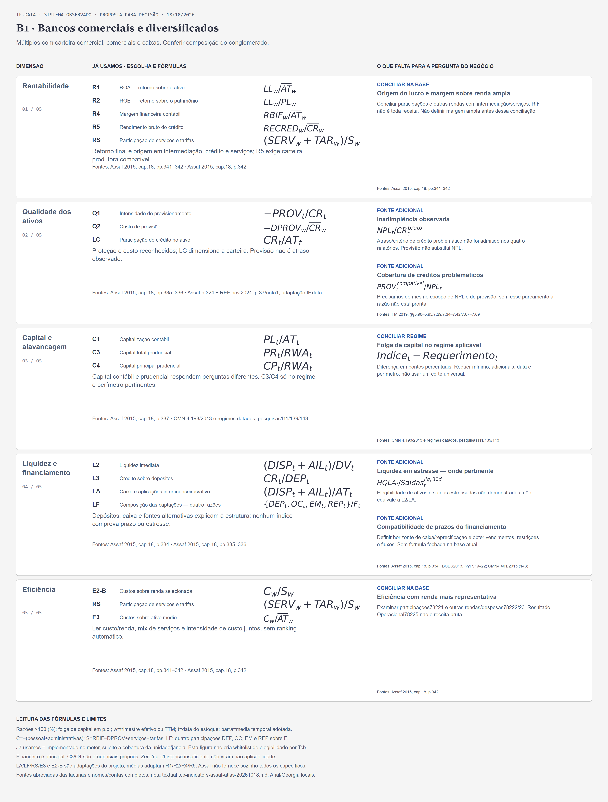
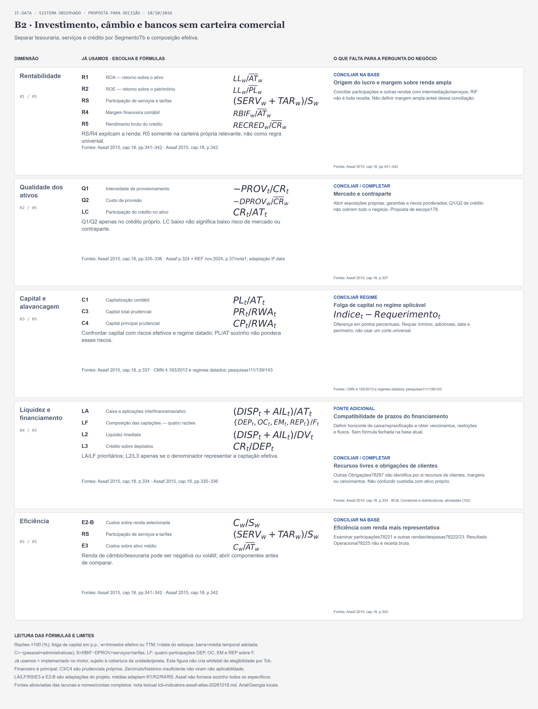
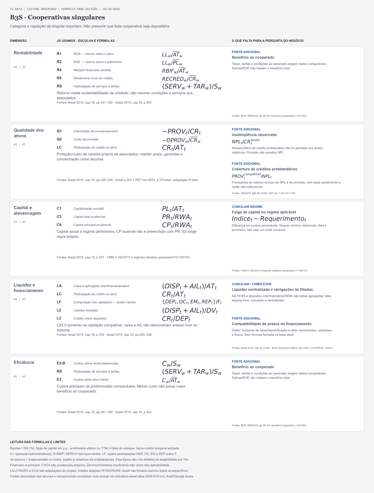
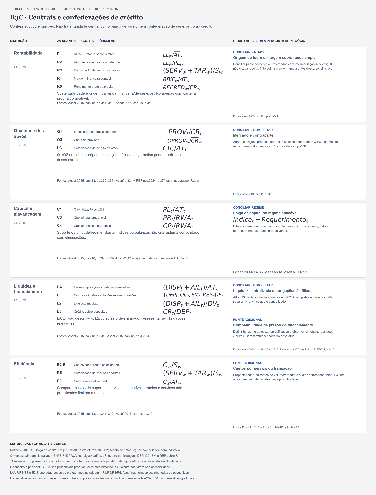
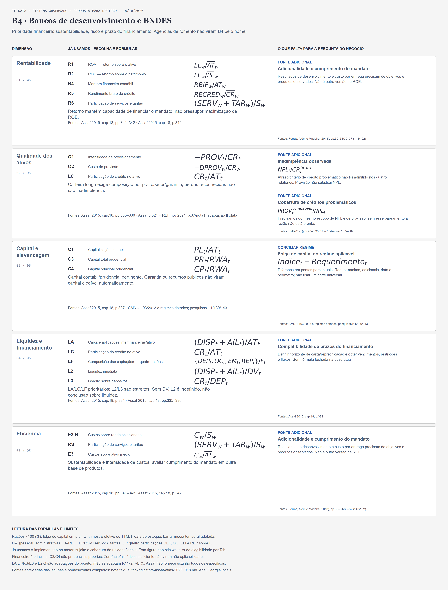
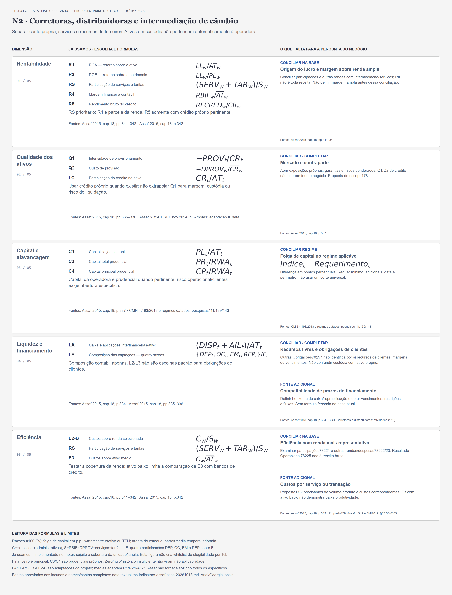
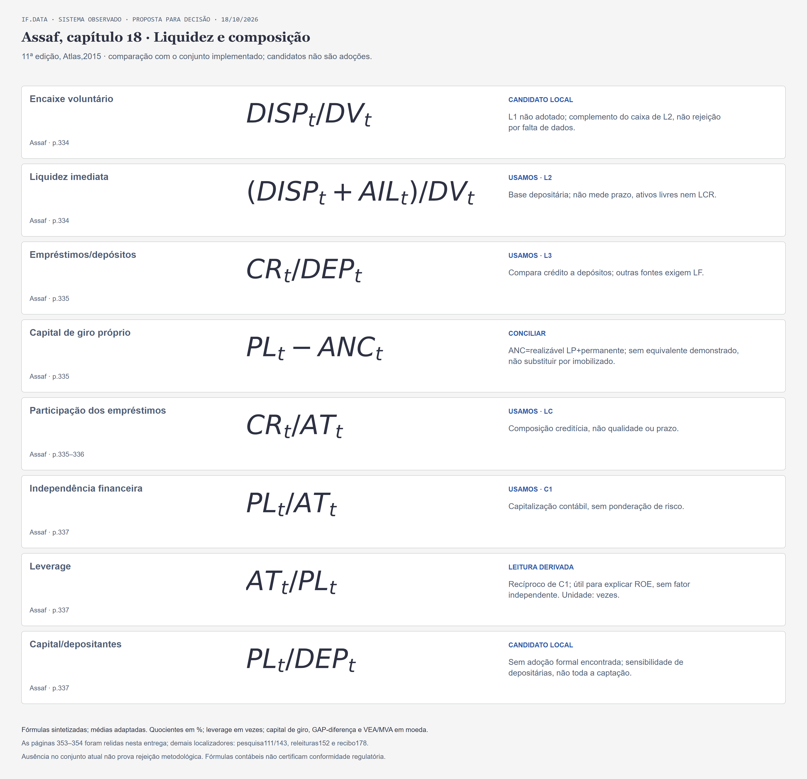
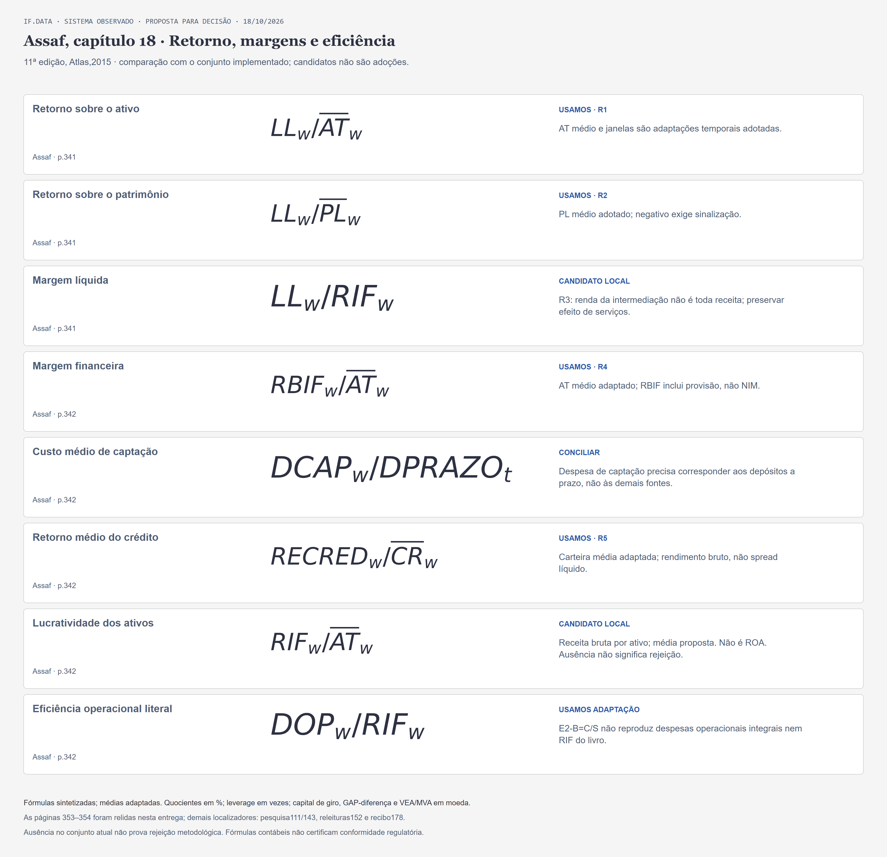
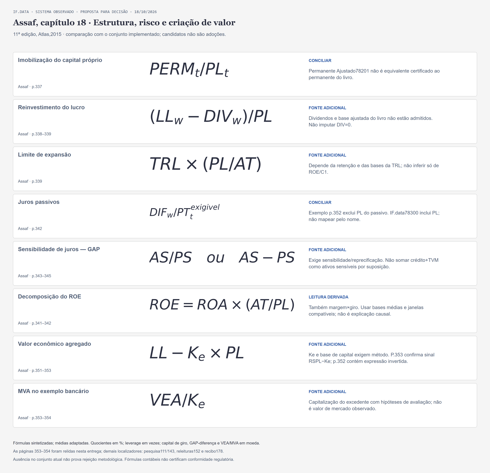

# Indicadores por Tcb: conjunto desejável, uso atual e plano de viabilidade

[Issue178](https://github.com/joaosantossgp/brazilian_banks_data_quality/issues/178) · 18/10/2026 · [Plano seletivo](../superpowers/plans/2026-10-18-tcb-indicators.md).

## Resultado e alcance

O conjunto atual contém **20 métricas em 17 famílias**: dez originais e dez complementares em sete famílias, pois LF tem quatro participações. R4/R5/LA/LC/LF/RS/E3 já foram implementados pela152; as figuras antigas que os chamam de propostas registram outra etapa. Esta entrega recomenda prioridades por negócio, compara o capítulo 18 e planeja viabilização. **Não implementa nem calcula novas razões, não adota fórmulas candidatas e não certifica cobertura integral das cinco dimensões.**

Universo: sistema IF.data observado completo2010–2024; vinculadas, restante e vínculo desconhecido em coortes próprias, sem limitar a32 companhias. Financeiro principal, Prudencial e Individual próprios. Tcb orienta o primeiro recorte, refinado por SegmentoTb, contas, data e perímetro. Tc/Td/Sr contextualizam; SrAnalitico permanece derivado separado; Atividade não volta aos filtros. Não há fórmula diferente para cada cruzamento nem whitelist automática por Tcb. Classificação desconhecida não é exclusão.

“Desejável/ideal” significa pergunta econômica e medidas adequadas ao negócio, não máximo número de indicadores nem recomendação universal. Parte das lacunas exige fonte adicional; parte pode ser resolvida com contas existentes. Uma medida inadequada não encerra a dimensão. O foco é desempenho financeiro: benefício cooperativo e mandato de desenvolvimento são complementos próprios, não substitutos de retorno/custos.

## Estados e leitura comum

- **Já usamos:** implementado, com cobertura e regras de sinal/janela próprias; não implica valor disponível em toda unidade.
- **Candidato local:** componentes localizados; fórmula/fonte verificáveis, sem adoção automática. Disponibilidade contemporânea não certifica média/TTM.
- **Conciliar:** falta fechar abrangência, conta, sinal, regime ou denominador. Se a evidência local bastar, não exige coleta adicional.
- **Fonte adicional:** faltam componentes identificados, não simplesmente uma razão disponível de menor qualidade.
- **Leitura derivada:** identidade/recíproco útil, sem acrescentar informação independente ou compor score.

Razões percentuais são multiplicadas por100. t=data do estoque; w=trimestre efetivo ouTTM; barra=média temporal adotada com abertura e ponderação. Estoques não são somados no tempo. Fluxos acumulados respeitam reset semestral e trimestres disjuntos. Zero no denominador é indefinido; nulos, falta de histórico, negativos e não aplicabilidade permanecem distintos. Negativos/reversões legítimos são preservados. Agregação=ΣN/ΣD na mesma interseção válida, sem misturar fórmulas ou perspectivas; mediana/IQR descrevem unidades, não substituem o agregado. AT/crédito/PL e contagens acompanham cobertura; percentuais de ativos conhecidos não provam cobertura econômica integral.

## Dicionário de fórmulas e variáveis atuais

As contas abaixo são identificadoresIF.data, nãoCOSIF. Financeiro=TipoInstituicao=2, relatóriosResumo1/Ativo2/Passivo3/DRE4; capital=Tipo 1/relatório5, contexto prudencial próprio. Grupo/nome/definição/versionamento completos estão no [inventário de componentes143](financial-indicators-activity-components-20261016.csv), sem correspondência apenas por nome/código. Para Individual, usar os bindingsTipo3 e contratos próprios, não transplantar oTipo2.

| ID | Nome e fórmula (×100) | Contas/contextos | Fonte e adaptação |
|---|---|---|---|
| R1 | ROA — retorno sobre o ativo: $LL_w/\overline{AT}_w$ | LL78187/Resumo1; AT78182/Resumo1 | Assaf 2015, cap. 18, pp.341–342; Média temporal adaptada. |
| R2 | ROE — retorno sobre o patrimônio: $LL_w/\overline{PL}_w$ | LL78187; PL78186/Resumo1 | Assaf 2015, cap. 18, pp.341–342; Média temporal adaptada. |
| R4 | Margem financeira contábil: $RBIF_w/\overline{AT}_w$ | RBIF78215/DRE4; AT78182/Resumo1 | Assaf 2015, cap. 18, p. 342; Média temporal adaptada. |
| R5 | Rendimento bruto do crédito: $RECRED_w/\overline{CR}_w$ | RECRED78203/DRE4; CR78191/Ativo2 | Assaf 2015, cap. 18, p. 342; Média temporal adaptada. |
| Q1 | Intensidade de provisionamento: $-PROV_t/CR_t$ | PROV78192; CR78191/Ativo2 | Assaf p. 324 + REF nov.2024, p. 37/nota1; adaptação IF.data; Conceito/regime próprio. |
| Q2 | Custo de provisão: $-DPROV_w/\overline{CR}_w$ | DPROV78213/DRE4; CR78191/Ativo2 | Assaf p. 324 + REF nov.2024, p. 37/nota1; adaptação IF.data; Conceito/regime próprio. |
| C1 | Capitalização contábil: $PL_t/AT_t$ | PL78186; AT78182/Resumo1 | Assaf 2015, cap. 18, p. 337; Conceito/regime próprio. |
| C3 | Capital total prudencial: $PR_t/RWA_t$ | PR79649; RWA79665/Capital5/Tipo1 | CMN 4.193/2013 e regimes datados; pesquisas111/139/143; Conceito/regime próprio. |
| C4 | Capital principal prudencial: $CP_t/RWA_t$ | CP79645; RWA79665/Capital5/Tipo1 | CMN 4.193/2013 e regimes datados; pesquisas111/139/143; Conceito/regime próprio. |
| L2 | Liquidez imediata: $(DISP_t+AIL_t)/DV_t$ | DISP78188+AIL78189/Ativo2; DV78282/Passivo3 | Assaf 2015, cap. 18, p. 334; Conceito/regime próprio. |
| L3 | Crédito sobre depósitos: $CR_t/DEP_t$ | CR78191/Ativo2; DEP78287/Passivo3 | Assaf 2015, cap. 18, pp.335–336; Conceito/regime próprio. |
| LA | Caixa e aplicações interfinanceiras/ativo: $(DISP_t+AIL_t)/AT_t$ | 78188+78189/Ativo2; AT78182/Resumo1 | Assaf 2015, cap. 18, p. 334; Adaptação própria. |
| LC | Participação do crédito no ativo: $CR_t/AT_t$ | CR78191/Ativo2; AT78182/Resumo1 | Assaf 2015, cap. 18, pp.335–336; Conceito/regime próprio. |
| LF | Composição das captações — quatro razões: $\{DEP_t,OC_t,EM_t,REP_t\}/F_t$ | DEP78287, OC78288, EM78294, REP78295; F78185/Passivo3 | Assaf 2015, cap. 18, pp.335–336; Adaptação própria. |
| E2-B | Custos sobre renda selecionada: $C_w/S_w$ | C=−(78218+78219); S=78215−78213+78216+78217/DRE4 | Assaf 2015, cap. 18, p. 342; Adaptação própria. |
| RS | Participação de serviços e tarifas: $(SERV_w+TAR_w)/S_w$ | SERV78216; TAR78217; S definido em E2-B/DRE4 | Assaf 2015, cap. 18, pp.341–342; Adaptação própria. |
| E3 | Custos sobre ativo médio: $C_w/\overline{AT}_w$ | C=−(78218+78219)/DRE4; AT78182/Resumo1 | Assaf 2015, cap. 18, p. 342; Adaptação própria. |

LF significa quatro razões: DEP/F, OC/F, EM/F e REP/F. F éCaptações78185 noPassivo3, reconciliado com as quatro parcelas, não funding total do balanço. C é−(pessoal78218+administrativas78219); S éRBIF78215−DPROV78213+serviços78216+tarifas78217. Q1 inverte o sinal nativo da provisão; Q2 preserva reversão. R4 inclui provisão e não éNIM; R5 não desconta funding/perdas/custos. E2-B não reproduz IE literalAssaf/BCB/FMI. A planilha de componentes guarda os nomes literais, inclusive whitespace nativo.

## Oito quadros por Tcb e alternativa textual

Cada quadro mantém as cinco dimensões e põe atuais e lacunas lado a lado. Fórmula ausente nas lacunas significa especificação ainda não fechada; não foi inventada para completar uma célula. As razõesNPL/cobertura/LCR são conceitos bibliográficos, não bindings implementados ou exigências universais. A folga é diferença em pontos percentuais, dependente de regime.

### B1 — Bancos comerciais e diversificados

Múltiplos com carteira comercial, comerciais e caixas. Conferir composição do conglomerado.

[SVG ampliável](../agents/assets/tcb-indicators-b1-20261018.svg) · [PNG](../agents/assets/tcb-indicators-b1-20261018.png).

| Dimensão | Já usamos e motivo | Falta, fórmula quando definida e motivo |
|---|---|---|
| Rentabilidade | R1, R2, R4, R5, RS. Retorno final e origem em intermediação, crédito e serviços; R5 exige carteira produtora compatível. | **Origem do lucro e margem sobre renda ampla** (CONCILIAR NA BASE); fórmula após especificação; Conciliar participações e outras rendas com intermediação/serviços; RIF não é toda receita. Não definir margem ampla antes dessa conciliação. Fonte: Assaf 2015, cap. 18, pp.341–342. |
| Qualidade dos ativos | Q1, Q2, LC. Proteção e custo reconhecidos; LC dimensiona a carteira. Provisão não é atraso observado. | **Inadimplência observada** (FONTE ADICIONAL); $NPL_t/CR^{bruto}_t$; Atraso/critério de crédito problemático não foi admitido nos quatro relatórios. Provisão não substitui NPL. Fonte: FMI 2019, §§5.90–5.95/7.29/7.34–7.42/7.67–7.69. **Cobertura de créditos problemáticos** (FONTE ADICIONAL); $PROV^{compativel}_t/NPL_t$; Precisamos do mesmo escopo de NPL e de provisão; sem esse pareamento a razão não está pronta. Fonte: FMI 2019, §§5.90–5.95/7.29/7.34–7.42/7.67–7.69. |
| Capital e alavancagem | C1, C3, C4. Capital contábil e prudencial respondem perguntas diferentes. C3/C4 só no regime e perímetro pertinentes. | **Folga de capital no regime aplicável** (CONCILIAR REGIME); $Indice_t-Requerimento_t$; Diferença em pontos percentuais. Requer mínimo, adicionais, data e perímetro; não usar um corte universal. Fonte: CMN 4.193/2013 e regimes datados; pesquisas111/139/143. |
| Liquidez e financiamento | L2, L3, LA, LF. Depósitos, caixa e fontes alternativas explicam a estrutura; nenhum índice comprova prazo ou estresse. | **Liquidez em estresse — onde pertinente** (FONTE ADICIONAL); $HQLA_t/Saidas^{liq,30d}_t$; Elegibilidade de ativos e saídas estressadas não demonstradas; não equivale a L2/LA. Fonte: BCBS2013, §§17/19–22; CMN4.401/2015 (143). **Compatibilidade de prazos do financiamento** (FONTE ADICIONAL); fórmula após especificação; Definir horizonte de caixa/reprecificação e obter vencimentos, restrições e fluxos. Sem fórmula fechada na base atual. Fonte: Assaf 2015, cap. 18, p. 334. |
| Eficiência | E2-B, RS, E3. Ler custo/renda, mix de serviços e intensidade de custo juntos, sem ranking automático. | **Eficiência com renda mais representativa** (CONCILIAR NA BASE); fórmula após especificação; Examinar participações78221 e outras rendas/despesas78222/23. Resultado Operacional78225 não é receita bruta. Fonte: Assaf 2015, cap. 18, p. 342. |

### B2 — Investimento, câmbio e bancos sem carteira comercial

Separar tesouraria, serviços e crédito por SegmentoTb e composição efetiva.

[SVG ampliável](../agents/assets/tcb-indicators-b2-20261018.svg) · [PNG](../agents/assets/tcb-indicators-b2-20261018.png).

| Dimensão | Já usamos e motivo | Falta, fórmula quando definida e motivo |
|---|---|---|
| Rentabilidade | R1, R2, RS, R4, R5. RS/R4 explicam a renda; R5 somente na carteira própria relevante, não como regra universal. | **Origem do lucro e margem sobre renda ampla** (CONCILIAR NA BASE); fórmula após especificação; Conciliar participações e outras rendas com intermediação/serviços; RIF não é toda receita. Não definir margem ampla antes dessa conciliação. Fonte: Assaf 2015, cap. 18, pp.341–342. |
| Qualidade dos ativos | Q1, Q2, LC. Q1/Q2 apenas no crédito próprio. LC baixo não significa baixo risco de mercado ou contraparte. | **Mercado e contraparte** (CONCILIAR / COMPLETAR); fórmula após especificação; Abrir exposições próprias, garantias e riscos ponderados; Q1/Q2 de crédito não cobrem todo o negócio. Proposta de escopo178. Fonte: Assaf 2015, cap. 18, p. 337. |
| Capital e alavancagem | C1, C3, C4. Confrontar capital com riscos efetivos e regime datado; PL/AT sozinho não pondera esses riscos. | **Folga de capital no regime aplicável** (CONCILIAR REGIME); $Indice_t-Requerimento_t$; Diferença em pontos percentuais. Requer mínimo, adicionais, data e perímetro; não usar um corte universal. Fonte: CMN 4.193/2013 e regimes datados; pesquisas111/139/143. |
| Liquidez e financiamento | LA, LF, L2, L3. LA/LF prioritários; L2/L3 apenas se o denominador representar a captação efetiva. | **Compatibilidade de prazos do financiamento** (FONTE ADICIONAL); fórmula após especificação; Definir horizonte de caixa/reprecificação e obter vencimentos, restrições e fluxos. Sem fórmula fechada na base atual. Fonte: Assaf 2015, cap. 18, p. 334. **Recursos livres e obrigações de clientes** (CONCILIAR / COMPLETAR); fórmula após especificação; Outras Obrigações78297 não identifica por si recursos de clientes, margens ou vencimentos. Não confundir custódia com ativo próprio. Fonte: BCB, Corretoras e distribuidoras; atividades (152). |
| Eficiência | E2-B, RS, E3. Renda de câmbio/tesouraria pode ser negativa ou volátil; abrir componentes antes de comparar. | **Eficiência com renda mais representativa** (CONCILIAR NA BASE); fórmula após especificação; Examinar participações78221 e outras rendas/despesas78222/23. Resultado Operacional78225 não é receita bruta. Fonte: Assaf 2015, cap. 18, p. 342. |

### B3S — Cooperativas singulares

Categoria e captação da singular importam. Não presumir que toda cooperativa seja depositária.

[SVG ampliável](../agents/assets/tcb-indicators-b3s-20261018.svg) · [PNG](../agents/assets/tcb-indicators-b3s-20261018.png).

| Dimensão | Já usamos e motivo | Falta, fórmula quando definida e motivo |
|---|---|---|
| Rentabilidade | R1, R2, R4, R5, RS. Retorno mede sustentabilidade da unidade; não resume condições e serviços aos associados. | **Benefício ao cooperado** (FONTE ADICIONAL); fórmula após especificação; Taxas, tarifas e condições ao associado exigem dados comparáveis. Sobras/ROE não medem o benefício total. Fonte: BCB, REB2022, pp.39–43; benefício cooperativo (143/152). |
| Qualidade dos ativos | Q1, Q2, LC. Proteção/custo da carteira própria de associados; manter prazo, garantias e concentração como lacunas. | **Inadimplência observada** (FONTE ADICIONAL); $NPL_t/CR^{bruto}_t$; Atraso/critério de crédito problemático não foi admitido nos quatro relatórios. Provisão não substitui NPL. Fonte: FMI 2019, §§5.90–5.95/7.29/7.34–7.42/7.67–7.69. **Cobertura de créditos problemáticos** (FONTE ADICIONAL); $PROV^{compativel}_t/NPL_t$; Precisamos do mesmo escopo de NPL e de provisão; sem esse pareamento a razão não está pronta. Fonte: FMI 2019, §§5.90–5.95/7.29/7.34–7.42/7.67–7.69. |
| Capital e alavancagem | C1, C3, C4. Capital social e regime pertinentes; CP ausente não é preenchido com PR. S5 exige regra própria. | **Folga de capital no regime aplicável** (CONCILIAR REGIME); $Indice_t-Requerimento_t$; Diferença em pontos percentuais. Requer mínimo, adicionais, data e perímetro; não usar um corte universal. Fonte: CMN 4.193/2013 e regimes datados; pesquisas111/139/143. |
| Liquidez e financiamento | LA, LC, LF, L2, L3. L2/L3 somente na captação compatível; caixa e AIL não demonstram acesso livre ao sistema. | **Liquidez centralizada e obrigações às filiadas** (CONCILIAR / COMPLETAR); fórmula após especificação; AIL78189 e depósitos interfinanceiros78284 são pistas agregadas; falta separar livre, vinculado e centralizado. Fonte: BCB, Panorama SNCC dez.2024, p. 22/PDF22, nota10. **Compatibilidade de prazos do financiamento** (FONTE ADICIONAL); fórmula após especificação; Definir horizonte de caixa/reprecificação e obter vencimentos, restrições e fluxos. Sem fórmula fechada na base atual. Fonte: Assaf 2015, cap. 18, p. 334. |
| Eficiência | E2-B, RS, E3. Custos precisam de porte/modelo comparáveis. Menor custo não prova maior benefício ao cooperado. | **Benefício ao cooperado** (FONTE ADICIONAL); fórmula após especificação; Taxas, tarifas e condições ao associado exigem dados comparáveis. Sobras/ROE não medem o benefício total. Fonte: BCB, REB2022, pp.39–43; benefício cooperativo (143/152). |

### B3C — Centrais e confederações de crédito

Conferir subtipo e funções. Não tratar unidade central como banco de varejo nem confederação de serviços como crédito.

[SVG ampliável](../agents/assets/tcb-indicators-b3c-20261018.svg) · [PNG](../agents/assets/tcb-indicators-b3c-20261018.png).

| Dimensão | Já usamos e motivo | Falta, fórmula quando definida e motivo |
|---|---|---|
| Rentabilidade | R1, R2, RS, R4, R5. Sustentabilidade e origem da renda financeira/de serviços; R5 apenas com carteira própria compatível. | **Origem do lucro e margem sobre renda ampla** (CONCILIAR NA BASE); fórmula após especificação; Conciliar participações e outras rendas com intermediação/serviços; RIF não é toda receita. Não definir margem ampla antes dessa conciliação. Fonte: Assaf 2015, cap. 18, pp.341–342. |
| Qualidade dos ativos | Q1, Q2, LC. Q1/Q2 no crédito próprio; exposição a filiadas e garantias pode existir fora dessa carteira. | **Mercado e contraparte** (CONCILIAR / COMPLETAR); fórmula após especificação; Abrir exposições próprias, garantias e riscos ponderados; Q1/Q2 de crédito não cobrem todo o negócio. Proposta de escopo178. Fonte: Assaf 2015, cap. 18, p. 337. |
| Capital e alavancagem | C1, C3, C4. Suporte da unidade/regime. Somar índices ou balanços não cria sistema consolidado com eliminações. | **Folga de capital no regime aplicável** (CONCILIAR REGIME); $Indice_t-Requerimento_t$; Diferença em pontos percentuais. Requer mínimo, adicionais, data e perímetro; não usar um corte universal. Fonte: CMN 4.193/2013 e regimes datados; pesquisas111/139/143. |
| Liquidez e financiamento | LA, LF, L2, L3. LA/LF são descritivos. L2/L3 só se o denominador representar as obrigações relevantes. | **Liquidez centralizada e obrigações às filiadas** (CONCILIAR / COMPLETAR); fórmula após especificação; AIL78189 e depósitos interfinanceiros78284 são pistas agregadas; falta separar livre, vinculado e centralizado. Fonte: BCB, Panorama SNCC dez.2024, p. 22/PDF22, nota10. **Compatibilidade de prazos do financiamento** (FONTE ADICIONAL); fórmula após especificação; Definir horizonte de caixa/reprecificação e obter vencimentos, restrições e fluxos. Sem fórmula fechada na base atual. Fonte: Assaf 2015, cap. 18, p. 334. |
| Eficiência | E2-B, RS, E3. Comparar custos de suporte e serviços compatíveis; rateios e serviços não precificados limitam a razão. | **Custos por serviço ou transação** (FONTE ADICIONAL); fórmula após especificação; Proposta178: precisamos de volume/produto e custos correspondentes. E3 com ativo baixo não demonstra baixa produtividade. Fonte: Proposta178; Assaf p. 342 e FMI 2019, §§7.56–7.63. |

### B4 — Bancos de desenvolvimento e BNDES

Prioridade financeira: sustentabilidade, risco e prazo do financiamento. Agências de fomento não viram B4 pelo nome.

[SVG ampliável](../agents/assets/tcb-indicators-b4-20261018.svg) · [PNG](../agents/assets/tcb-indicators-b4-20261018.png).

| Dimensão | Já usamos e motivo | Falta, fórmula quando definida e motivo |
|---|---|---|
| Rentabilidade | R1, R2, R4, R5, RS. Retorno mantém capacidade de financiar o mandato; não pressupor maximização de ROE. | **Adicionalidade e cumprimento do mandato** (FONTE ADICIONAL); fórmula após especificação; Resultados de desenvolvimento e custo por entrega precisam de objetivos e produtos observados. Não é outra versão de ROE. Fonte: Ferraz, Além e Madeira (2013), pp.30–31/35–37 (143/152). |
| Qualidade dos ativos | Q1, Q2, LC. Carteira longa exige composição por prazo/setor/garantia; perdas reconhecidas não são inadimplência. | **Inadimplência observada** (FONTE ADICIONAL); $NPL_t/CR^{bruto}_t$; Atraso/critério de crédito problemático não foi admitido nos quatro relatórios. Provisão não substitui NPL. Fonte: FMI 2019, §§5.90–5.95/7.29/7.34–7.42/7.67–7.69. **Cobertura de créditos problemáticos** (FONTE ADICIONAL); $PROV^{compativel}_t/NPL_t$; Precisamos do mesmo escopo de NPL e de provisão; sem esse pareamento a razão não está pronta. Fonte: FMI 2019, §§5.90–5.95/7.29/7.34–7.42/7.67–7.69. |
| Capital e alavancagem | C1, C3, C4. Capital contábil/prudencial pertinente. Garantia ou recursos públicos não viram capital elegível automaticamente. | **Folga de capital no regime aplicável** (CONCILIAR REGIME); $Indice_t-Requerimento_t$; Diferença em pontos percentuais. Requer mínimo, adicionais, data e perímetro; não usar um corte universal. Fonte: CMN 4.193/2013 e regimes datados; pesquisas111/139/143. |
| Liquidez e financiamento | LA, LC, LF, L2, L3. LA/LC/LF prioritários; L2/L3 são estreitos. Sem DV, L2 é indefinido, não conclusão sobre liquidez. | **Compatibilidade de prazos do financiamento** (FONTE ADICIONAL); fórmula após especificação; Definir horizonte de caixa/reprecificação e obter vencimentos, restrições e fluxos. Sem fórmula fechada na base atual. Fonte: Assaf 2015, cap. 18, p. 334. |
| Eficiência | E2-B, RS, E3. Sustentabilidade e intensidade de custos; avaliar cumprimento do mandato em outra base de produtos. | **Adicionalidade e cumprimento do mandato** (FONTE ADICIONAL); fórmula após especificação; Resultados de desenvolvimento e custo por entrega precisam de objetivos e produtos observados. Não é outra versão de ROE. Fonte: Ferraz, Além e Madeira (2013), pp.30–31/35–37 (143/152). |

### N1 — Crédito não bancário, imobiliário, arrendamento e fomento

Desdobrar SCFI, SCD, SEP, leasing, imobiliário e agência. Tcb sozinho não escolhe a carteira.

[SVG ampliável](../agents/assets/tcb-indicators-n1-20261018.svg) · [PNG](../agents/assets/tcb-indicators-n1-20261018.png).

| Dimensão | Já usamos e motivo | Falta, fórmula quando definida e motivo |
|---|---|---|
| Rentabilidade | R1, R2, R4, R5, RS. R5 só no crédito próprio; empréstimos entre terceiros não são automaticamente ativo da plataforma. | **Qualidade e rendimento do arrendamento** (CONCILIAR NA BASE); fórmula após especificação; 78194/95/97/98 e rendas78204/despesas78211 existem; carteira, sinais e ajustes precisam conciliação antes da fórmula. Fonte: BCB/SCFI; distinção histórica SCD/SEP (152); regime por data. |
| Qualidade dos ativos | Q1, Q2, LC. Q1/Q2 apenas no CR compatível; arrendamento precisa de carteira e provisão próprias. | **Qualidade e rendimento do arrendamento** (CONCILIAR NA BASE); fórmula após especificação; 78194/95/97/98 e rendas78204/despesas78211 existem; carteira, sinais e ajustes precisam conciliação antes da fórmula. Fonte: BCB/SCFI; distinção histórica SCD/SEP (152); regime por data. **Inadimplência observada** (FONTE ADICIONAL); $NPL_t/CR^{bruto}_t$; Atraso/critério de crédito problemático não foi admitido nos quatro relatórios. Provisão não substitui NPL. Fonte: FMI 2019, §§5.90–5.95/7.29/7.34–7.42/7.67–7.69. |
| Capital e alavancagem | C1, C3, C4. Capital/regime específicos por subtipo e data. Não impor o mesmo requerimento a toda categoria. | **Folga de capital no regime aplicável** (CONCILIAR REGIME); $Indice_t-Requerimento_t$; Diferença em pontos percentuais. Requer mínimo, adicionais, data e perímetro; não usar um corte universal. Fonte: CMN 4.193/2013 e regimes datados; pesquisas111/139/143. |
| Liquidez e financiamento | LA, LC, LF, L3. Emissões/repasses e prazo importam; L3 somente quando depósitos fizerem sentido. LC não inclui leasing por nome. | **Compatibilidade de prazos do financiamento** (FONTE ADICIONAL); fórmula após especificação; Definir horizonte de caixa/reprecificação e obter vencimentos, restrições e fluxos. Sem fórmula fechada na base atual. Fonte: Assaf 2015, cap. 18, p. 334. |
| Eficiência | E2-B, RS, E3. Renda e custos devem representar crédito, leasing ou plataforma. E3 isolado penaliza modelos com pouco ativo. | **Eficiência com renda mais representativa** (CONCILIAR NA BASE); fórmula após especificação; Examinar participações78221 e outras rendas/despesas78222/23. Resultado Operacional78225 não é receita bruta. Fonte: Assaf 2015, cap. 18, p. 342. **Custos por serviço ou transação** (FONTE ADICIONAL); fórmula após especificação; Proposta178: precisamos de volume/produto e custos correspondentes. E3 com ativo baixo não demonstra baixa produtividade. Fonte: Proposta178; Assaf p. 342 e FMI 2019, §§7.56–7.63. |

### N2 — Corretoras, distribuidoras e intermediação de câmbio

Separar conta própria, serviços e recursos de terceiros. Ativos em custódia não pertencem automaticamente à operadora.

[SVG ampliável](../agents/assets/tcb-indicators-n2-20261018.svg) · [PNG](../agents/assets/tcb-indicators-n2-20261018.png).

| Dimensão | Já usamos e motivo | Falta, fórmula quando definida e motivo |
|---|---|---|
| Rentabilidade | R1, R2, RS, R4, R5. RS prioritário; R4 é parcela da renda. R5 somente com crédito próprio pertinente. | **Origem do lucro e margem sobre renda ampla** (CONCILIAR NA BASE); fórmula após especificação; Conciliar participações e outras rendas com intermediação/serviços; RIF não é toda receita. Não definir margem ampla antes dessa conciliação. Fonte: Assaf 2015, cap. 18, pp.341–342. |
| Qualidade dos ativos | Q1, Q2, LC. Usar crédito próprio quando existir; não extrapolar Q1 para margem, custódia ou risco de liquidação. | **Mercado e contraparte** (CONCILIAR / COMPLETAR); fórmula após especificação; Abrir exposições próprias, garantias e riscos ponderados; Q1/Q2 de crédito não cobrem todo o negócio. Proposta de escopo178. Fonte: Assaf 2015, cap. 18, p. 337. |
| Capital e alavancagem | C1, C3, C4. Capital da operadora e prudencial quando pertinente; risco operacional/clientes exige abertura específica. | **Folga de capital no regime aplicável** (CONCILIAR REGIME); $Indice_t-Requerimento_t$; Diferença em pontos percentuais. Requer mínimo, adicionais, data e perímetro; não usar um corte universal. Fonte: CMN 4.193/2013 e regimes datados; pesquisas111/139/143. |
| Liquidez e financiamento | LA, LF. Composição contábil apenas. L2/L3 não são escolhas padrão para obrigações de clientes. | **Recursos livres e obrigações de clientes** (CONCILIAR / COMPLETAR); fórmula após especificação; Outras Obrigações78297 não identifica por si recursos de clientes, margens ou vencimentos. Não confundir custódia com ativo próprio. Fonte: BCB, Corretoras e distribuidoras; atividades (152). **Compatibilidade de prazos do financiamento** (FONTE ADICIONAL); fórmula após especificação; Definir horizonte de caixa/reprecificação e obter vencimentos, restrições e fluxos. Sem fórmula fechada na base atual. Fonte: Assaf 2015, cap. 18, p. 334. |
| Eficiência | E2-B, RS, E3. Testar a cobertura da renda; ativo baixo limita a comparação de E3 com bancos de crédito. | **Eficiência com renda mais representativa** (CONCILIAR NA BASE); fórmula após especificação; Examinar participações78221 e outras rendas/despesas78222/23. Resultado Operacional78225 não é receita bruta. Fonte: Assaf 2015, cap. 18, p. 342. **Custos por serviço ou transação** (FONTE ADICIONAL); fórmula após especificação; Proposta178: precisamos de volume/produto e custos correspondentes. E3 com ativo baixo não demonstra baixa produtividade. Fonte: Proposta178; Assaf p. 342 e FMI 2019, §§7.56–7.63. |

### N4 — Instituições de pagamento

Conferir modalidade, data e perímetro. Rentabilidade da operadora não comprova proteção dos usuários.

[SVG ampliável](../agents/assets/tcb-indicators-n4-20261018.svg) · [PNG](../agents/assets/tcb-indicators-n4-20261018.png).

| Dimensão | Já usamos e motivo | Falta, fórmula quando definida e motivo |
|---|---|---|
| Rentabilidade | R1, R2, RS, R4, R5. RS prioritário; R4 parcial. R5 apenas com carteira própria compatível, inclusive no grupo observado. | **Origem do lucro e margem sobre renda ampla** (CONCILIAR NA BASE); fórmula após especificação; Conciliar participações e outras rendas com intermediação/serviços; RIF não é toda receita. Não definir margem ampla antes dessa conciliação. Fonte: Assaf 2015, cap. 18, pp.341–342. |
| Qualidade dos ativos | Q1, Q2, LC. Somente crédito próprio compatível; ausência de CR não torna nulos os riscos do negócio. | **Mercado e contraparte** (CONCILIAR / COMPLETAR); fórmula após especificação; Abrir exposições próprias, garantias e riscos ponderados; Q1/Q2 de crédito não cobrem todo o negócio. Proposta de escopo178. Fonte: Assaf 2015, cap. 18, p. 337. |
| Capital e alavancagem | C1, C3, C4. Capital/regime da operadora quando pertinente. PR de banco do grupo não preenche capital da IP. | **Folga de capital no regime aplicável** (CONCILIAR REGIME); $Indice_t-Requerimento_t$; Diferença em pontos percentuais. Requer mínimo, adicionais, data e perímetro; não usar um corte universal. Fonte: CMN 4.193/2013 e regimes datados; pesquisas111/139/143. **Salvaguarda por modalidade de pagamento** (FONTE ADICIONAL); fórmula após especificação; Faltam obrigação dos usuários e recursos elegíveis/vinculados no mesmo perímetro. Conta de pagamento não é depósito à vista. Fonte: Lei12.865/2013, arts.6/12/12-A–12-C; redação datada (152). |
| Liquidez e financiamento | LA, LF. Descrevem ativos/fontes; não demonstram recursos livres ou salvaguarda. DV não é conta de pagamento. | **Salvaguarda por modalidade de pagamento** (FONTE ADICIONAL); fórmula após especificação; Faltam obrigação dos usuários e recursos elegíveis/vinculados no mesmo perímetro. Conta de pagamento não é depósito à vista. Fonte: Lei12.865/2013, arts.6/12/12-A–12-C; redação datada (152). |
| Eficiência | E2-B, RS, E3. Renda de serviços e custos compatíveis. Não chamar custo/ativo de eficiência técnica ou custo/transação. | **Eficiência com renda mais representativa** (CONCILIAR NA BASE); fórmula após especificação; Examinar participações78221 e outras rendas/despesas78222/23. Resultado Operacional78225 não é receita bruta. Fonte: Assaf 2015, cap. 18, p. 342. **Custos por serviço ou transação** (FONTE ADICIONAL); fórmula após especificação; Proposta178: precisamos de volume/produto e custos correspondentes. E3 com ativo baixo não demonstra baixa produtividade. Fonte: Proposta178; Assaf p. 342 e FMI 2019, §§7.56–7.63. |

## Comparação com o capítulo 18 do Assaf

Fonte: ASSAF NETO, Alexandre. *Estrutura e análise de balanços: um enfoque econômico-financeiro*.11.ed.Atlas,2015,cap. 18,pp.332–354. Exemplar privado, SHA256 `d41dccd16d2a9c174fb95cd87e5d3abd0666f461514d8402594367cc913d367b`. Não redistribuímos páginas do livro. A coluna de motivo distingue constatação no corpus de recomendação desta entrega: não foi encontrada decisão formal de rejeição dePL/DEP ouRIF/AT. L1/R3 permaneciam candidatos de baixa prioridade na143; não eram impossíveis nem descartados definitivamente.

**Símbolos adicionais do capítulo:** ANC=ativo não circulante; PERM=ativo permanente; DIV=dividendos; DCAP=despesas financeiras de captação de mercado; DPRAZO=depósitos a prazo; DIF=despesas de intermediação financeira; PTexigível=obrigações excluindo PL; AS/PS=ativos/passivos sensíveis a juros; TRL=taxa de reinvestimento do lucro; Ke=custo do capital próprio; RSPL=retorno sobre PL; VEA=valor econômico agregado. Essas letras sintetizam conceitos do livro; não são contas IF.data já conciliadas. Capital de giro e VEA/MVA são valores monetários, leverage é vezes e GAP pode ser razão ou diferença, conforme expressão.

### Liquidez e composição

[SVG ampliável](../agents/assets/tcb-indicators-assaf-01-20261018.svg).

| Indicador | Fórmula sintetizada | Página | Estado e motivo |
|---|---|---|---|
| Encaixe voluntário | $DISP_t/DV_t$ | 334 | **CANDIDATO LOCAL**. L1 não adotado; complemento do caixa de L2, não rejeição por falta de dados. |
| Liquidez imediata | $(DISP_t+AIL_t)/DV_t$ | 334 | **USAMOS · L2**. Base depositária; não mede prazo, ativos livres nem LCR. |
| Empréstimos/depósitos | $CR_t/DEP_t$ | 335 | **USAMOS · L3**. Compara crédito a depósitos; outras fontes exigem LF. |
| Capital de giro próprio | $PL_t-ANC_t$ | 335 | **CONCILIAR**. ANC=realizável LP+permanente; sem equivalente demonstrado, não substituir por imobilizado. |
| Participação dos empréstimos | $CR_t/AT_t$ | 335–336 | **USAMOS · LC**. Composição creditícia, não qualidade ou prazo. |
| Independência financeira | $PL_t/AT_t$ | 337 | **USAMOS · C1**. Capitalização contábil, sem ponderação de risco. |
| Leverage | $AT_t/PL_t$ | 337 | **LEITURA DERIVADA**. Recíproco de C1; útil para explicar ROE, sem fator independente. Unidade: vezes. |
| Capital/depositantes | $PL_t/DEP_t$ | 337 | **CANDIDATO LOCAL**. Sem adoção formal encontrada; sensibilidade de depositárias, não toda a captação. |

### Retorno, margens e eficiência

[SVG ampliável](../agents/assets/tcb-indicators-assaf-02-20261018.svg).

| Indicador | Fórmula sintetizada | Página | Estado e motivo |
|---|---|---|---|
| Retorno sobre o ativo | $LL_w/\overline{AT}_w$ | 341 | **USAMOS · R1**. AT médio e janelas são adaptações temporais adotadas. |
| Retorno sobre o patrimônio | $LL_w/\overline{PL}_w$ | 341 | **USAMOS · R2**. PL médio adotado; negativo exige sinalização. |
| Margem líquida | $LL_w/RIF_w$ | 341 | **CANDIDATO LOCAL**. R3: renda da intermediação não é toda receita; preservar efeito de serviços. |
| Margem financeira | $RBIF_w/\overline{AT}_w$ | 342 | **USAMOS · R4**. AT médio adaptado; RBIF inclui provisão, não NIM. |
| Custo médio de captação | $DCAP_w/DPRAZO_t$ | 342 | **CONCILIAR**. Despesa de captação precisa corresponder aos depósitos a prazo, não às demais fontes. |
| Retorno médio do crédito | $RECRED_w/\overline{CR}_w$ | 342 | **USAMOS · R5**. Carteira média adaptada; rendimento bruto, não spread líquido. |
| Lucratividade dos ativos | $RIF_w/\overline{AT}_w$ | 342 | **CANDIDATO LOCAL**. Receita bruta por ativo; média proposta. Não é ROA. Ausência não significa rejeição. |
| Eficiência operacional literal | $DOP_w/RIF_w$ | 342 | **USAMOS ADAPTAÇÃO**. E2-B=C/S não reproduz despesas operacionais integrais nem RIF do livro. |

### Estrutura, risco e criação de valor

[SVG ampliável](../agents/assets/tcb-indicators-assaf-03-20261018.svg).

| Indicador | Fórmula sintetizada | Página | Estado e motivo |
|---|---|---|---|
| Imobilização do capital próprio | $PERM_t/PL_t$ | 337 | **CONCILIAR**. Permanente Ajustado78201 não é equivalente certificado ao permanente do livro. |
| Reinvestimento do lucro | $(LL_w-DIV_w)/PL$ | 338–339 | **FONTE ADICIONAL**. Dividendos e base ajustada do livro não estão admitidos. Não imputar DIV=0. |
| Limite de expansão | $TRL\times(PL/AT)$ | 339 | **FONTE ADICIONAL**. Depende da retenção e das bases da TRL; não inferir só de ROE/C1. |
| Juros passivos | $DIF_w/PT^{exigivel}_t$ | 342 | **CONCILIAR**. Exemplo p. 352 exclui PL do passivo. IF.data78300 inclui PL; não mapear pelo nome. |
| Sensibilidade de juros — GAP | $AS/PS\quad ou\quad AS-PS$ | 343–345 | **FONTE ADICIONAL**. Exige sensibilidade/reprecificação. Não somar crédito+TVM como ativos sensíveis por suposição. |
| Decomposição do ROE | $ROE=ROA\times(AT/PL)$ | 341–342 | **LEITURA DERIVADA**. Também margem×giro. Usar bases médias e janelas compatíveis; não é explicação causal. |
| Valor econômico agregado | $LL-K_e\times PL$ | 351–353 | **FONTE ADICIONAL**. Ke e base de capital exigem método. P.353 confirma sinal RSPL−Ke; p. 352 contém expressão invertida. |
| MVA no exemplo bancário | $VEA/K_e$ | 353–354 | **FONTE ADICIONAL**. Capitalização do excedente com hipóteses de avaliação; não é valor de mercado observado. |

A base média usada emR1/R2/R4/R5 é adaptação temporal explícita. A p. 339 traz ajuste dePL no contexto deTRL; não transplantar esse ajuste automaticamente para todos osROEs. Na decomposiçãoROE=margem×giro, giro=RIF/PL e todas as bases devem ser compatíveis. Retenção=(LL−DIV)/LL é componente daTRL, não indicador implementado separado. O exemplo histórico deBasileia não estabelece mínimos uniformes em2010–2024.

Contraprovas: p. 352 demonstra Passivo Total exigível+PL=AT, impedindo equivalência com78300; p. 353 confirmaVEA=(RSPL−Ke)×PL eLL−Ke×PL, enquanto expressão alternativa da p. 352 inverte o sinal. P.349 tem inconsistência de capital de giro e unidade de leverage já documentada111; não importamos resultados dos exemplos. MVA=VEA/Ke é a simplificação do exemplo bancário, não preço observado ou avaliação já adotada.

Q1/Q2 têm complemento contábil/regulatório, não são índices literais de inadimplência do cap. 18. C3/C4 exigem normas e dados prudenciais próprios. LA/LF/RS/E3 eE2-B são adaptações: fonte conceitual não é atribuição literal da fórmula.

## Viabilidade comprovada agora e o que falta

Diagnóstico178: somente leitura, sem cálculo de razões ou reconstrução de fluxos. Ponteiro atual autenticado: pacote `historical-links32-composition-20261018-run3`, manifestSHA256 `d47a15746fc7b6cdaaa0c82cf511622e8bb8cd89386808682b57d6271a89bb60`; tabelaunit_periods autenticada. Catálogo438 e pacoteOData financeiro autenticados pelos leitores existentes, com pins no recibo privado. Cadastro usado é o da própria unidade/período no pacote, sem fallback por operadora/nome. Contextos duplicados por chave conhecida interrompem a auditoria. Linhas nativas sem unidade admitida/código nulo ficam em inventário separado, não são convertidas em população zero.

Auditadas 89.476 unidades-trimestre financeiras e 60trimestres201003–202412. A matriz privada tem 2.886 linhas candidato×trimestre×Tcb, inclusive desconhecido quando observado, e inventário nominal com coorte/companhias. ParaL1/R3/RIF_AT/PL_DEP contamos componentes finitos juntos e sinal do denominador contemporâneo. Para leasing/renda ampliada contamos somente presença conjunta de componentes, sem certificar fórmula ou atividade. RIF negativa e zeros não foram descartados da contagem conjunta.

**4T2024 — componentes conjuntos com denominador positivo/total de unidades esperadas:** não é resultado trimestral/TTM calculável, cobertura temporal contínua ou representatividade de ativos.

| Tcb | L1: caixa/DV | R3: LL/RIF | RIF/AT | PL/depósitos |
|---|---|---|---|---|
| B1 | 88/97 | 97/97 | 97/97 | 95/97 |
| B2 | 5/31 | 31/31 | 31/31 | 27/31 |
| B3S | 570/753 | 753/753 | 753/753 | 593/753 |
| B3C | 3/29 | 27/29 | 27/29 | 12/29 |
| B4 | 1/4 | 4/4 | 4/4 | 4/4 |
| N1 | 8/226 | 217/226 | 224/226 | 99/226 |
| N2 | 0/136 | 127/136 | 135/136 | 35/136 |
| N4 | 1/146 | 133/146 | 144/146 | 104/146 |

Nessa data,1.415/1.422 unidades têm todos os componentes contemporâneos das seis famílias auditadas; sete apresentam lacuna. Isso inclui saldos zero: os componentes de leasing estarem presentes não significa que1.415 unidades operem leasing. RIF/AT ainda depende de abertura/fluxos para a média proposta. R3 requer harmonizar definições deLL em201903, inclusive as restrições da ponte aceita. L1 ePL/DEP são estoques e têm caminho técnico mais curto; sua prioridade econômica é menor que sanar renda/leasing nos negócios afetados.

O [diagnóstico176](data-readiness-diagnostic-20261018.md) mede cobertura dos indicadores atuais: ROATTMem4T2024 tem 1.337/1.422 unidades e99,50%doAT conhecido. Não confundir esses resultados elegíveis com1.415 componentes contemporâneos. Permanecem28 resultados indisponíveis na transiçãoCaixa; N2/N1 têm janelas com perda importante de representatividade. Esta entrega não corrige essas séries nem repete a robustez da175. Não estimamos ativos cobertos pelos candidatos novos nesta auditoria; essa medida e as listas nominais por período são gates do piloto futuro, não percentuais presumidos.

### Fila proposta de realização

1. **Reaproveitar atuais, sem recálculo:** usar as20 métricas persistidas e os avisosTcb; tratar cobertura/continuidade e decisões175/176 separadamente.
2. **Piloto local simples:** L1/R3/RIF_AT/PL_DEP como sensibilidades após escolha humana; L1 ePL_DEP requerem estoque, R3/RIF_AT requerem fluxo/histórico. Não escolher pela cobertura mais alta.
3. **Conciliação prioritária local:** renda/custos amplos paraN2/N4/grupos e carteira/rendas de leasing emN1. Aproveitar catálogo/contas existentes; só criar fórmula final após fechar identidade/sinal/abrangência.
4. **Pesquisa dirigida de lacunas:** centralizaçãoB3S/B3C; prazo/fonte institucionalB4/N1; recursos de clientesN2 e salvaguardaN4. Primeiro procurar abertura admitida, depois identificar a fonte adicional necessária. Sem aquisição implícita.
5. **Fonte adicional e método próprios:** NPL/cobertura, estresse/maturidade, benefício/mandato/volume, dividendos/Ke/reprecificação. Cada produto deve definir pergunta, unidade, janela e componentes antes de calcular.

O [plano](../superpowers/plans/2026-10-18-tcb-indicators.md) delimita arquivos, entradas, fórmulas candidatas, testes e saídas de cada fatia. Nenhuma fila adota automaticamente uma medida nem bloqueia análise de outras dimensões; fórmulas distintas não entram num único agregado.

## Fontes e proveniência

- Assaf: pp.332–352 e notas de leitura reaproveitadas da [111](financial-dimensions-literature-20261014.provenance.md), releituras [143](financial-indicators-activity-review-20261016.provenance.md)/[152](ifdata-tcb-indicator-adequacy-20261017.md). Nesta178, revisão de fontes releu visualmente334/335/337/338/339/341/342/343/352/353/354; as duas últimas ampliam o alcance declarado anteriormente. PDF=impressa+21. Notas privadas com páginas/claims, sem publicar o scan.
- **F:** FMI, *Financial Soundness Indicators Compilation Guide2019*, final, [PDF oficial](https://www.imf.org/-/media/files/data/2019/2019-fsi-guide.pdf), §§5.90–5.95,7.29/7.34–7.42,7.46–7.69,9.1–9.6. NPL/ativos líquidos/perímetros/custos; leitura da143 reaproveitada, distinta do draft111. LCR/NSFR: BCBS2013/2014 e requisitosCMN datados na143; não são exigências universais. LA não reproduz elegibilidade de ativos líquidos doFMI.
- **P:** CMN4.193/2013 e regimes/adicionais datados, pesquisa111/143 e [diagnóstico139](ifdata-c4-prudential-gaps-20261016.md); não aplicar texto vigente retroativamente nem substituirCPporPR.
- **Q:** Assaf p. 324; CMN2.682/1999,arts.1–9; [REFnovembro2024](https://www.bcb.gov.br/content/publicacoes/ref/202410/RELESTAB202410-refPub.pdf),p. 37/gráfico1.2.3.6/nota1. Evidência111/143 reaproveitada; provisão não éNPL.
- **CO:** [BCB, PanoramaSNCCdez2024](https://www.bcb.gov.br/content/estabilidadefinanceira/coopcredpanorama/Panorama_Cooperativas_SNCC_FINAL_dez2024.pdf),p. 22/PDF22,nota10/gráficos3.1.6–3.1.7. Conferência focal web nesta178 identifica centralização e distingue aplicação direta; o localizador específico refina a menção mais ampla depp.24–26 na152, sem alterar a nota histórica. Não retroagir composição2024a2010.
- **BEN:** [BCB, Relatório de Economia Bancária2022](https://www.bcb.gov.br/content/publicacoes/relatorioeconomiabancaria/reb2022p.pdf),pp.39–43, benefício ao cooperado, evidência143/152 reaproveitada. Essa referência sustenta a distinção de objetivos; o indicador final de benefício não está definido nesta178. A fonte COde centralização não é usada como prova de benefício.
- **I:** proposta analítica desta178 de examinar custos por produto/serviço, confrontada com Assafp.342 e FMI 2019§§7.56–7.63. Não é fórmula atribuída literalmente a essas fontes nem conclusão empírica de produtividade. Analogamente, abrir mercado/contraparte é recomendação de alcance da178 a partir da ressalva de riscosAssafp.337; não uma métrica publicada para cadaTcb pela páginaBCBCorretoras.
- **BD:** [Ferraz, Além e Madeira,2013](https://web.bndes.gov.br/bib/jspui/bitstream/1408/1421/1/RB%2040_final-A.pdf),pp.30–31/35–37, leitura143/152 reaproveitada; sustentabilidade/mandato são argumento acadêmico, não regra regulatória.
- **G:** [BCB, corretoras/distribuidoras](https://www.bcb.gov.br/pre/composicao/corretoras_distribuidoras.asp?frame=1),seções atividades, leitura152 reaproveitada; não prova licença individual datada.
- **NC/IP:** distinções por subtipo e data na152; [Lei12.865/2013](https://www.planalto.gov.br/ccivil_03/_ato2011-2014/2013/lei/l12865.htm),arts.6/12/12-A–12-C. NormasSCD/SEP precisam cronologia antes de aplicação; a descrição histórica de2018 não é regra operacional constante até2024. Não diagnosticamos conformidade.

Estratégia: confronto dirigido dos indicadores do capítulo 18 com registros111/143/152, implementação atual e catálogo/cobertura; sem revisão sistemática ou busca exaustiva de modalidades. TeoriaAssaf, evidência acadêmicaBD, descrição institucionalBCB e requisito regulatório são papéis diferentes. Fontes complementares foram reaproveitadas, salvo conferência focal do localizador COexplicitada acima; não anunciamos nova leitura integral. Fórmulas sem binding ficam explicitamente abertas.

## Verificação e limites de entrega

Preparação privada exclusiva `.scratch/tcb-assaf-plan-20261018/`: audit.py, input-pin.json, raw-pin.json, catalog-selected.json, candidate-contexts.json, candidate-joint-coverage.csv, candidate-joint-nominal.json, unmapped-native-rows.json, audit-receipt.json, source-review.md, fontesHTML e render/recibos. Artefatos públicos limitam-se a esta nota, plano, onze paresSVG/PNG e entradaREADME. Sem imagens do livro, dados nominais privados ou HTMLnoGit. Fontes de textoArial/Georgia são substituições locais deliberadas; fórmulasLaTeX renderizadas emSVG, sem dependência deCDN.

O diagnóstico usaDecimal para presença/sinal; não chama o avaliador financeiro, não arredonda dados e preserva originais. A primeira tentativa interrompeu em registros nativos de código nulo, depois em cadastro nulo; a versão aceita preserva ambos os estados e inventário à parte. A execução final tem verificação de unicidade e hashes. Revisão por fatias e conferência visual/SHA constarão daIssue; esse registro de método não antecipaPASS. A implementação futura e adoção permanecem fora desta entrega.
